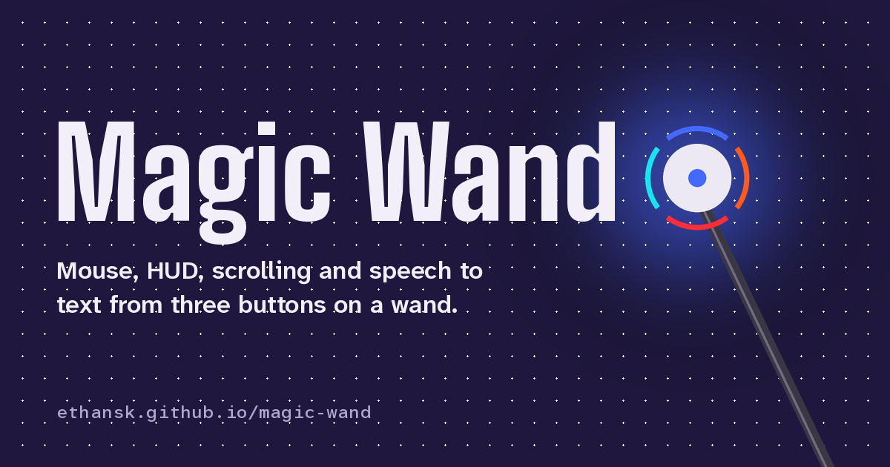

# [Magic Wand ↗](https://ethansk.github.io/magic-wand/)

This is the `magic-wand/` component of the controller monorepo. Run the commands in this guide from this folder:

```sh
cd magic-wand  # From the repository root
```

The published site stays in `../docs/`; root `npm run check` checks every component.

[Try the wand](https://ethansk.github.io/magic-wand/) · [Ethan’s setup](https://ethansk.github.io/ethan-setup/) · [Agentic Mouse](https://ethansk.github.io/agentic-mouse/) · [Agent Flow](https://ethansk.github.io/AgentFlow/)

<!-- wand:intro -->
Mouse, HUD, scrolling and speech to text from three buttons on a wand.

Turning the wand moves my Mac’s pointer or the Agentic Mouse HUD outline. A Puck.js at the tip reads the rotation and sends it over Bluetooth.

**The age of AI doesn’t need a keyboard.** The wand is my step toward that, with pointing, HUD cards and Agent Flow dictation.
<!-- /wand:intro -->



The website runs the wand’s own device code in your browser, with the Mac side simulated, so you can try the button controls without the hardware. Nothing connects to a wand, Bluetooth or your Mac.

## Controls

<!-- wand:controls -->
**Top** (`D30`) · Speech to text

| Gesture | Result |
| --- | --- |
| Tap | Start Agent Flow dictation |
| Tap again | Stop and paste |

- Recording stays red in mouse mode. HUD, review, scrolling and loading keep their own indication.
- Putting the wand down never stops dictation. Use Top to stop and paste.

**Middle** (`D2`) · Agentic Mouse HUD

| Gesture | Result |
| --- | --- |
| Quick tap from closed | Switch app once |
| Hold, turn, release | Open the HUD, point to a card and use it on release |
| Choose a submenu | Keep the submenu open; hold Middle again to choose within it |
| Choose a wheel control | Keep it selected; hold Middle again and turn the wand to adjust it |
| Double tap | Close the entire HUD |

- The installed wand uses a radial HUD with Switch App in the centre. The browser demo retains its earlier grid.
- The browser demo shows the main HUD; native app-specific controls and desk detection need the installed integrations.
- Ordinary actions close the HUD on release. Submenus and selected wheel controls stay open for the next hold; they have no inactivity timeout. Bottom and speech remain independent.
- Keep Middle held on Switch App for 0.5 seconds after hold qualification to enter its chooser directly, then move left or right; release finishes. A quicker release still selects it for the next hold. Moving away resets the wait. A quick tap from closed switches once and closes.
- Bottom, Middle and speech are independent. Mouse follow can keep running while review is selected.
- In VS Code, tap Review changes or Stage files to enter and hide the HUD. Move through a rough quarter-circle or diamond corner: clockwise for one next step, anticlockwise for one previous step, with no button held. A full loop gives four steps; straight up/down flicks are disabled. Tap Middle once to cancel and exit after at most 300 ms, double-click to switch between Review changes and Stage files, retaining the selection and including the current file without staging, or hold it for about half a second to stage the working selection and keep reviewing. Navigation stays frozen until release. The floating indicator says “(Hold to commit selection)” and names the mode a double-click will enter. Review changes uses Better Git eyes mode; Stage files uses its whole-file selection.
- Review input only runs while VS Code is frontmost. The small review indicator stays above Agent Flow.
- The native wand home HUD has Play/Pause after Utility around the ring. It uses the Mac’s standard media key, without changing either physical mouse.

**Bottom** (`D1`) · Mouse

| Gesture | Result |
| --- | --- |
| Tap from off | Enter high-sensitivity follow without clicking |
| Stop after moving in HIGH | Click once after a 200 ms pause |
| Tap while following | Stop following without clicking |
| Hold | Over a scroll area, drag in any direction to scroll; hold still to continue and drag the other way to reverse. A confirmed draggable target drags instead. Release stops the gesture. |
| Tap, then hold the second press | Drag with the mouse button down; release to drop |
| Double tap | Centre the pointer on the main screen and enable mouse follow after the 300 ms triple-tap window; keep HUD and review selection unchanged |
| Triple tap | Start screenshot selection; move to select the area, then stop to capture |

- Control V3 keeps short taps and tap-then-hold dragging unchanged. The existing 220 ms cutoff separates a tap from a hold.
- A plain hold scrolls a scroll area or drags a confirmed draggable target. Unknown targets keep scrolling. Tap, then hold the second press to drag explicitly. The pointer stays fixed while scrolling until release.
- Middle switches to the HUD. The pointer stays within real display edges.
- Release a completed scroll to enable mouse follow at the current pointer position, even if follow was off before scrolling.
- Bottom never opens, closes or clears the Middle HUD or review selection.
- V3 uses straight strokes in either axis, including diagonals. Holding still continues the captured speed; a new stroke can change speed or reverse without releasing. Circular page-scroll recognition is disabled; V2 remains selectable.
- Keep moving the wand slightly while you are not certain about placement so it does not click. Stop when you are ready. The pointer must still be moving; tiny movements filtered out as hand noise do not prevent a click.
- Screenshot temporarily moves the pointer even with mouse follow off. From the HUD Screenshot action, tap Bottom once to start selecting; stopping after movement ends the selection. Triple tap starts selection without another tap. Finishing or cancelling restores the previous mouse-follow choice.

**Lights**, highest priority first

| Light | Shows |
| --- | --- |
| Updating | Blinks orange while loading or updating the device code |
| Disconnected | Orange while unavailable |
| Calibrating | Keep it still with no buttons pressed for two seconds |
| Sleeping | Off after a minute on the desk; pickup restores the light |
| Scrolling | Cyan |
| App review | Green for app review; purple for VS Code file staging |
| Pointer | Steady blue; recording takes priority and shows red |
| HUD | Orange |
| Recording | Steady red while recording, including mouse mode. HUD, review, scrolling and loading keep their own colours. |
| Idle | Off |
<!-- /wand:controls -->

## User options

Wand Receiver is a background Mac app. Its wand icon in the menu bar provides:

- **Control version → V2 · Hold to scroll**: hold Bottom and start left/right for
  horizontal scrolling, or up/down for vertical scrolling. Continue in circles;
  release to stop. A plain hold scrolls a scroll area or drags a confirmed
  draggable target; an unknown target keeps scrolling.
  To drag, tap Bottom, then press again and keep it held. Release to drop.
  Short taps retain their existing mouse behavior.
- **Control version → V1 · Pointer** restores the previous Bottom gestures. The exact
  pre-V2 implementation is also saved at `controls-v1.0.0`; see `control-versions/`.
- **Options → Review with nods and shakes** is off by default. When enabled,
  an up-and-down motion goes next and a side-to-side motion goes previous in
  Review changes or Stage files. Every clear direction change makes a step. It replaces only their circles and flicks.
- **Options → Rotation-independent controls** keeps screen directions upright while
  rotating the wand. Flick scrolling is available only in Control V1.

The existing 220 ms tap-versus-hold cutoff is unchanged. No movement buffer is added.
Scrolling uses the pointer position captured at press. Native dragging requires an
explicit tap-then-hold. HUD, speech, VS Code review and two-button scrolling are unchanged.
The browser demo still shows Control V1; V2 needs the native receiver.

## How it works

1. **Puck.js.** Espruino JavaScript on the wand reads the gyro and three buttons, sends raw pointing samples to the Mac and decides each button gesture.
2. **Bluetooth UART.** Short text lines carry raw gyro samples (`@RAW`), calibration and tuning (`@ZERO`), legacy pointer reports (`@WAND x,y,buttons`), HUD angles (`@NAV`), scrolling (`@SCROLL`), Bottom edges (`@BOTTOM`), Middle presses (`@MIDDLE`), Top presses (`@STT`) and light changes.
3. **Wand Receiver.** A background Mac app (Swift, CoreBluetooth) filters raw pointing samples with the same sensitivity and noise rejection, posts ordinary pointer, click and wheel events, sends HUD commands to Agentic Mouse and Top presses to Agent Flow over same-user local sockets, and sends the recording state back to the wand.
4. **Lights.** The wand shows its mode on the Puck’s RGB light; Agent Flow’s recording notifications keep it red while recording.

The Puck also advertises as a Bluetooth mouse, but macOS pairing stalled, so the receiver switches mouse reports to the UART link. On every connection the receiver checks the device code’s version and the bridge’s SHA-256; it uploads only what differs, one statement at a time, because one large command ran the Puck out of memory.

### Needs

<!-- wand:dependencies -->
- [Agentic Mouse](https://ethansk.github.io/agentic-mouse/): Draws the HUD and runs its cards. Wand support is in Ethan’s local build and isn’t published yet.
- [Agent Flow](https://ethansk.github.io/AgentFlow/): Records and pastes dictation. The public build accepts its mouse controls; wand input isn’t published yet.
- [Espruino](https://www.espruino.com/): JavaScript firmware on the Puck.js. Public. The first upload uses the Espruino Web IDE.
<!-- /wand:dependencies -->

Without Agentic Mouse and Agent Flow wand support, pointing, clicking, dragging and scrolling still work; Middle and Top have nothing to talk to.

The wand’s main HUD uses ordinary Enter, like the physical mice. Native wand integration is supplied as incremental patches under `integrations/agentic-mouse/`; it is not on Agentic Mouse’s public main yet. The latest installed native delta, [`wand-chat-keys-review-toggle.patch`](integrations/agentic-mouse/wand-chat-keys-review-toggle.patch), adds repeatable Keys actions, the review-mode toggle and its floating hint, and the native new-chat adapter. The new-chat adapter still needs Agent Flow and receiver orchestration; that shortcut is not yet complete.

## Hardware

- Puck.js v2.1 at the tip of a roughly 50 cm carbon-fibre tube.
- Three separate wired momentary buttons on the grip: Top to `D30`, Middle to `D2`, Bottom to `D1`, each also to `GND`. The Puck’s internal pull-ups make a press read low.

No photo yet; the website shows a schematic. Lighter replacement switches have been researched but aren’t fitted, so they aren’t described here.

<details>
<summary>Tuning</summary>

Holding Bottom uses one-third of the normal pointer gain, for both temporary movement and
tap-then-hold dragging. Released-button follow keeps the normal gain. HUD movement and scrolling
keep their own settings. The factor is applied before fractional pointer counts are accumulated;
The pointer uses a 0.2-degree radial tolerance for hand wobble, with quiet re-centering.
LOW release clicks, holds the pointer for 300 ms and continues prior HIGH mode.
From off, LOW release clicks and returns to off. Tap-then-hold drags objects or text, then resumes prior HIGH after the same short pause.
Tiny starting nudges and reversals need to cross the angular tolerance; Ethan confirmed that noise rejection feels good.

<!-- wand:tuning -->
| Setting | Value | Note |
| --- | --- | --- |
| Pointer gain | 86.4 counts per degree | 20% below the earlier 108 |
| Vertical | × 1.4 | Up and down move further than sideways |
| Fine aim | 35% gain below 2°/s | Full gain from 18°/s |
| Noise zone | Up to 1.2°/s | Measured during calibration |
| Sensor | 104 Hz requested | About 50 Hz fully processed in a recent measurement |
| Bluetooth interval | 15 ms requested |  |
| Button-jolt guard | 50 ms after a press, 70 ms after a release | Motion in the guard is dropped, not replayed |
| Cold start | 96 ms settling | Skipped when the sensor is still warm |
| Gyro sleep | After 1 s idle | Accelerometer stays at 1.6 Hz for pickup; off on disconnect |
| Hold | 220 ms | Longer presses count as holds |
| LOW movement delay | 0 ms |  |
| HIGH stop-to-click | 200 ms still | One click after deliberate movement; no repeat while still |
| Double-click window | 0.3 s | Read from the Mac’s setting |
| Scrolling | Horizontal × 1.4 | Mac wheel gain 0.8 |
| Middle report | After 80 ms | So Bottom + Middle can become a scroll |
| Reports | Every 30 ms | While the HUD or scrolling is active |
| Calibration | 2 s still, no buttons pressed | Kept across reconnects |
<!-- /wand:tuning -->

</details>

## Status

<!-- wand:status -->
- Installed: staying on the centre Switch App item for 0.5 seconds after hold qualification enters its chooser without releasing Middle. Moving away restarts that dwell; stale telemetry prevents entry. Motion before arming is discarded, and releasing finishes the same gesture. Native checks pass; physical gesture acceptance remains pending.
- Installed: Review changes and Stage files switch within the same pending Better Git selection and include the current file. No files are staged by switching. Better Git 1.2.135 is released and active; receiver 1.2.96 is installed with settings preserved. Receiver and Mini checks pass. The device remained asleep during installation; physical gesture acceptance remains pending.
- Installed: double-click Middle toggles Review changes and Stage files without staging. The floating indicator names the other mode. A single click cancels and exits after at most 300 ms; holding for half a second still stages the selection and stays in that mode. Pointer movement is unchanged. Receiver, native interaction and timer checks pass; physical button acceptance remains pending.
- Installed: triple Bottom starts screenshot selection; the HUD Screenshot action uses one Bottom tap, movement and the existing stop-to-click detector to finish. Double-tap centering waits up to 300 ms to distinguish a third tap. Pointer movement is not buffered. Recording red takes priority over mouse blue, and loading blinks orange. Complete saved bytes and clean startup with calibration passed; physical screenshot acceptance remains pending.
- Installed: each circular Wand HUD wedge has its own masked glass backing, clearer text and a gentle selection lift. Gaps and space around the wheel stay transparent. The armed dotted outline moves; Reduce Motion keeps it static. Native rendering and interaction checks passed; physical Copy/Paste acceptance remains pending.
- Installed: the Review changes and Stage files indicators say “Hold to commit selection”. Selection is the current term for the pending group; holding stages it without making a Git commit. Native tests and both rendered indicators passed.
- Installed: all three grip buttons turn the wand off; any single grip button wakes manual or automatic sleep. The wake press is consumed until every button is released. Five-minute automatic deep sleep and the two-blink cue are unchanged. Saved bytes and clean startup verified; physical any-button wake acceptance pending.
- Installed: shared click and hold cues distinguish a card action from held wheel or wand adjustments. Copy/Paste names Space explicitly. Native checks and rendered layout inspection passed; physical gesture acceptance is pending.
- Installed: held Switch App adjustment shares the normal HIGH mouse sensitivity calculation, including fine movement and orientation correction. Other HUD controls keep their existing angular input. Native and receiver checks pass; physical feel is awaiting acceptance.
- Installed: the complete saved program includes the corrected Bottom press, calibration restore and button-wake sleep. Clean startup was verified before reconnecting the receiver, with no code re-upload. A full five-minute sleep/button-wake cycle was observed on 24 October; physical battery-removal remains unverified.
- Installed: unheld movement can leave the dotted Switch App card without switching applications. The dotted cue appears during a qualified Middle hold; release still arms the card. Passive HUD selection survives pauses, and Bottom scrolling stays independent. Native and receiver regression checks pass; physical acceptance is pending.
- Installed: radial text is larger, with gentle card-aligned tilt only when it earns more readable space. The visible wand HUD stays anchored while Agent Flow changes its panel; reopening refreshes recorder clearance. Native tests and rendered layout checks passed; physical acceptance is pending.
- Installed: hold Middle to show and steer the radial HUD, then release to use the outlined card. Submenus and adjustable wheel cards stay open for the next hold. Quick tap from closed switches app once. The centre Switch App chooser still supports horizontal movement on a second hold. Native interaction tests passed; physical acceptance is pending.
- Installed: larger mixed-case radial labels, a continuous liquid centre-to-ring transition, and ordinary Enter in the wand home HUD. Native layout, morph continuity and key-output checks passed; real-device feel remains for user acceptance.
- Installed: the wand HUD is a radial wheel with Switch App in the centre and the other available actions around it. Native checks and installed visual inspection passed; physical selection feel still needs acceptance.
- Installed: Bottom hold scrolls a scrolling surface or drags a confirmed draggable target. Unknown or late target results stay on the scrolling path. Native lifecycle checks passed; physical app coverage is pending.
- Installed: waking restores the mouse-follow choice from before rest. Manual choices and recording pauses take precedence. Native checks passed; physical acceptance is pending.
- Control V3 replaces circular page scrolling with straight-drag velocity: continue while held still and reverse with another stroke. Automated lifecycle checks pass; physical acceptance is pending.
- Installed: Wand Receiver 1.2.79 emits plain single-button clicks with no modifier flags. Ordinary clicks cannot accumulate an OS double-click count. Synthetic event checks pass; the reported Codex new-window symptom still needs a physical check.
- Review navigation uses a redesigned spatial corner detector with learned noise tolerance. Reversible quarters, rough squares, slow motion and simulated device traces pass automated checks; physical acceptance is pending.
- A minute of confirmed desk rest turns the lights off and keeps low-rate pickup sensing. Pickup or a button restores the light. Rest never stops dictation or dismisses the open HUD.
- Receiver reconnection now rejects echoed upload requests and failed-runtime ready markers. Updating, disconnected and calibration bridge states use orange; recording alone uses red.
- Wand-only VS Code shortcuts expose change review and file staging beside Switch App. Automated checks cover their input; physical acceptance is pending.
- HIGH stop-to-click uses a 200 ms rest interval. Automated timing checks passed; physical acceptance is pending.
- Releasing a completed page-scroll gesture enables mouse follow even if it started off. Automated checks passed; physical acceptance is pending.
- Wand Receiver has a menu-bar Options menu. Optional first-flick scrolling in V1 passes automated checks; physical gesture acceptance is pending.
- Shared orientation correction and full Middle double-tap dismissal pass automated checks; physical acceptance is pending.
- Held scrolling now stays locked until release; Bottom double tap recenters the pointer. Automated checks passed; these changes still need a physical check.
- Ethan confirmed the latest native pointing feels much smoother; the other experimental gestures still need a physical check.
- Held positioning clicks on release and resumes prior high sensitivity after 300 ms. Ethan confirmed the still-hand tolerance feels good.
- Ethan confirmed automatic pickup and put-down both work on receiver 1.2.35.
- HIGH dwell, held rough circles and VS Code review pass automated checks; physical acceptance is pending.
- End-to-end latency, accuracy and battery life haven’t been measured.

Receiver 1.2.96 (101) · device code `wand-441472ce965b` · bridge `f8639252` · updated 27 October 2026.
<!-- /wand:status -->

Source only: there’s no packaged receiver, signed app or release. [BUILDING.md](BUILDING.md) explains building the receiver and loading the device code.

## Repository

| Path | What it is |
| --- | --- |
| [`wand.json`](wand.json) | The one maintained description: controls, pins, lights, tuning, versions and dependencies |
| [`device/wand-mouse-prototype.js`](device/wand-mouse-prototype.js) | Base Puck program (Espruino JavaScript), loaded once from the Espruino Web IDE |
| [`device/wand-mode-bridge.js`](device/wand-mode-bridge.js) | The current controls, applied by the receiver over Bluetooth on top of the base program |
| [`device/generated/`](device/generated) | Upload commands, runtime, boot image and compacted bridge, built by `scripts/build.py` |
| [`receiver/`](receiver) | Wand Receiver’s Swift source and `Info.plist` |
| [`docs/`](../docs) | The GitHub Pages website; `docs/sim/` holds the in-browser simulation |
| [`data/`](data) | Synced Agentic Mouse HUD labels, the import lock and the vendored-file lock |
| [`tests/`](tests) | Device, simulation, manifest and website checks |

## Run the checks

Requires Python 3.10+ and Node.js 22+; there are no npm dependencies.

```sh
python3 scripts/build.py --check   # generated files match wand.json and the sources
python3 scripts/vendor.py --check  # Three.js and fonts match their lock
python3 scripts/check.py           # website checks only
node --test tests/*.test.*          # device code, receiver and HUD ports, manifest, site
npm --prefix .. run check          # repository-wide checks, including privacy
npm run serve
```

Then open [127.0.0.1:8848](http://127.0.0.1:8848/). The demo needs an HTTP server because its worker loads the device code with `fetch`.

## Updating the wand

Change the wand first, then this repository: import the sources, update `wand.json`, rebuild and test. [AGENTS.md](AGENTS.md) has the exact steps and the rules that keep the website honest. [SOURCES.md](SOURCES.md) records where everything came from and what was left out.

## Licence

Code is MIT licensed. Three.js keeps its MIT licence and the fonts their SIL Open Font License, in `docs/lib/` and `docs/fonts/`. Agentic Mouse’s HUD labels and colours come from its MIT-licensed public website. Puck.js and Espruino are products of Pur3 Ltd; this project isn’t affiliated with them.

## Hardware prototypes

The original wand is [Prototype V1](prototypes/README.md), preserved at
[`prototype-v1.0.0`](https://github.com/EthanSK/magic-wand/tree/prototype-v1.0.0).
New hardware prototypes get separate profiles so the V1 controls remain recoverable.
[Control Stones](../control-stones/README.md) contains the Sense hand-controller component and live sensor debug window.

## How-to videos

The [How To gallery](https://ethansk.github.io/magic-wand/how-to/) has twelve short narrated
guides, with captions, transcripts and links to individual actions. These are illustrations of
Control V2, not physical test recordings. [Tutorial maintenance](tutorials/README.md) explains
question lookup and the reproducible render pipeline.

<!-- Previously the repository root; this component and its source paths now live under magic-wand/. Published docs remain at ../docs/. -->
