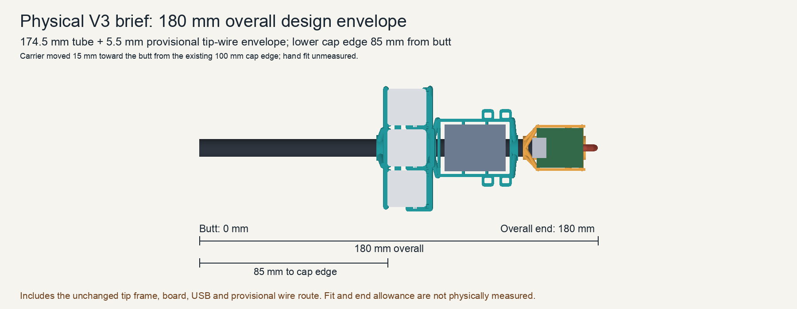
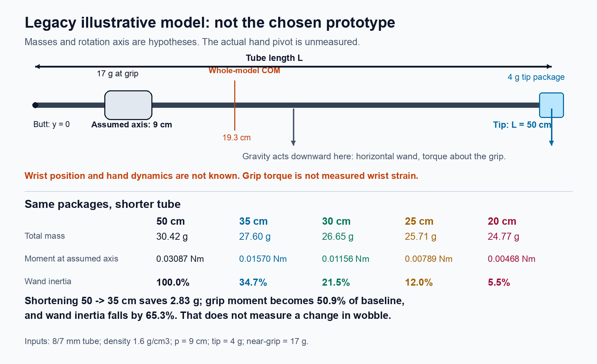
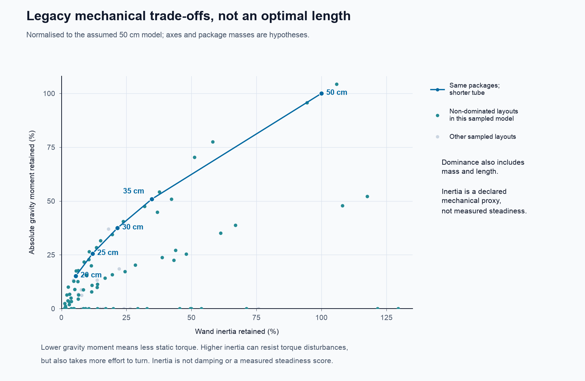

<!-- Generated by make-report.mjs; edit report-source.md and canonical inputs. -->

# Can mathematics choose the best wand?

**Review status:** primary derivation and independent Claude Opus 5.5 review,
including its corrective follow-up, are complete and consolidated below.
Numerical hypotheses are not physical measurements; the selected 18 cm CAD
case was subsequently applied and checked by Codex, not physically approved by Opus.

**It can prove the trade-offs and eliminate bad explanations. It cannot select
one best length from the available physical evidence.** The missing quantity is
how the complete hand–wand system responds to unwanted and intended motion.
Inertia alone is not that response, and the current component masses are not
measured.

The defensible conclusion is a family of choices, not a mathematically special
35 cm length. No arbitrary weighted score or “elbow” is used here. Retaining all
of the old inertia is **not** a requirement.

**Current user choice: 18 cm overall for the first physical
prototype.** This supersedes earlier size choices and is a user preference,
not an optimum inferred from inertia. The 35 cm half-moment calculation below
is retained only as a historical, conditional mathematical example.



This is the current CAD reference read directly from its owning R6 folder.
It is not a photograph or a measured physical assembly.

## What is known and what is assumed

- Ethan reports three keys, a small battery, a XIAO Sense at the tip and a carbon
  rod. His corrected existing-layout report puts the lower key-cluster edge
  approximately 10 cm from the butt. It does not identify the hand pivot or
  require the same key position on the new prototype.
- The identified stock tube is nominally 8 mm OD / 7 mm ID / 500 mm long. Stock
  length does not establish the current cut length. The actual holder revision,
  mass distribution, wrist position and mechanical damping remain unknown.
- The numerical examples below read the existing `illustrative-lengths` inputs
  from the canonical blueprint, with no independently maintained second set:
  **density 1.6 g/cm³; tip 4 g; near-grip package 17 g; grip 9 cm from butt**. These are assumptions, including a 500 mm baseline.
- The earlier 8–10 cm combined keys/grip wording was ambiguous. The 90 mm
  pivot and 80–100 mm range in legacy tables are hypothetical rotation axes,
  not a measured pivot or current physical bound.
- The 17 g near-grip package is treated as a point exactly at the grip for this
  example. It is not a measured keys/battery mass or zero-size physical object.
  The 4 g tip is the assumed *entire tip package*, not a claim about board mass.
- A separately verified supplier reference lists 3 g for the related original
  XIAO Sense tape-and-reel SKU 101991465. Combined with the existing
  0.595 g sliced-holder estimate, it gives **3.595 g before
  uncounted leads/retention** as a sensitivity example. It is not a weighed
  installed tip, and not a guaranteed lower bound for a different packaging
  variant. The canonical physical mass remains unknown. See the
  [supplier](https://www.mouser.sg/en/ProductDetail/Seeed-Studio/101991465?qs=KLj0QfLrw0Ftlesc1ABhhQ%3D%3D),
  [Seeed identity](https://www.seeedstudio.com/Seeed-Studio-XIAO-nRF52840-Sense-Tape-Reel-p-6566.html)
  and [manufacturer sheet](https://files.seeedstudio.com/Bazaar/product_pdf/101991465.pdf).
- Existing print receipts establish model-only estimates for the listed CAD
  prototypes. They do not establish the current assembly mass or its inertia.

## Selected prototype and its CAD reference

“V3” means the new physical prototype brief, not firmware Control V3 or the
historical R3 holder. The preferred envelope is **18 cm
overall**. The referenced CAD currently matches that overall length, but fit and physical acceptance remain unverified.

| Quantity | Referenced CAD value |
|---|---:|
| Overall envelope | 180.00 mm |
| Bare tube | 174.50 mm |
| Lower edge of illustrated keycaps | 85.00 mm |
| PCB geometric centre | 162.90 mm |
| Physical hand pivot | Unknown |

The positive wire envelope beyond the tube is a provisional CAD allowance,
not a measured assembly or cutting instruction. The PCB geometric centre is
not the centre of mass of the complete board/holder/wires package. The
referenced geometry remains owned by R6; this report reads it directly.
The referenced carrier has moved -15.00 mm along the shaft from
the existing-layout assumption to clear tip hardware. That is a proposed CAD
placement, not a new measurement of the hand or a physical comfort result.

The selected-CAD sensitivity cases below use hypothetical axes at
**0, 90, 125, 175 mm** from the butt. With the explicitly assumed package
masses and the two tip-point hypotheses, wand-only inertia ranges from
**2.79%–19.42%** of the corresponding 500 mm tube model.
This is an enumeration of assumptions, not a confidence interval, a measured
current-wand comparison or a prediction of steadiness.

## Axes and equations

Use metres and kilograms in these equations. The butt is `y=0`, the rod points
along `+y`, its end is `y=L`, and the model grip is `P=(0,p,0)`. `x` runs across
the keys and `z` points towards their faces. Pitch and yaw are rotations about
the transverse `x` and `z` axes; roll is about `y`.

For tube density \(\rho\), radii \(r_o,r_i\), line mass
\(\lambda=\rho\pi(r_o^2-r_i^2)\), and radial correction
\(a=(r_o^2+r_i^2)/4\):

\[
M=\lambda L+\sum_i m_i,\qquad
\mathbf r_G={\lambda L(0,L/2,0)+\sum_i m_i\mathbf r_i\over M}.
\]

The exact uniform hollow-tube transverse inertia about the grip is

\[
I_{x,\rm tube}=I_{z,\rm tube}
=\lambda\left[{(L-p)^3+p^3\over3}+La\right].
\]

Add each part with the parallel-axis rule:

\[
I_x=I_{x,\rm tube}+\sum_i\big[J_{x,i}+m_i((y_i-p)^2+z_i^2)\big],
\]
\[
I_z=I_{z,\rm tube}+\sum_i\big[J_{z,i}+m_i((y_i-p)^2+x_i^2)\big].
\]

`J` is each part's own inertia about its centre, after accounting for its
orientation. It is unknown for the physical parts. The point-mass model sets
it to zero and must not be mistaken for an exact full assembly calculation.
Tube roll inertia is \(I_{y,\rm tube}=\lambda L(r_o^2+r_i^2)/2\).
For an asymmetric measured layout, use the full tensor
\(\mathbf J=\int[(\mathbf r\cdot\mathbf r)\mathbf1-\mathbf r\mathbf r^T]dm\),
including the parts' rotated centre tensors; one scalar cannot describe every
pointing direction.

For a horizontal, on-axis wand define its signed first mass moment
\(Q=\lambda(L^2/2-pL)+\sum_i m_i(y_i-p)\). The magnitude of gravity torque
**about the grip** is \(g|Q|\). In general it is
\(\boldsymbol\tau_g=(\mathbf r_G-\mathbf r_P)\times M\mathbf g\).
An on-axis vertical wand has zero gravity torque about that axis location.

**These are not measured wrist torques.** The anatomical wrist is not known to
coincide with the grip. Replace `P` by the actual wrist/hand rotation axis for
that calculation; the hand and arm also contribute inertia and active forces.

## Shortening: the exact trade-off

**Legacy reference:** the following chart uses the earlier 500 mm tube and
hypothetical 90 mm pivot. It is not the selected 18 cm overall prototype.



For a point tip mass `m` at `L`, other masses at the grip and `x=L-p>=0`:

\[
I=\lambda[(x^3+p^3)/3+La]+mx^2,
\quad Q=\lambda(x^2-p^2)/2+mx.
\]

Holding `p`, the tube section and package masses fixed:

\[
{dM\over dL}=\lambda>0,\qquad {dQ\over dL}=\lambda x+m>0,
\]
\[
{dI\over dL}=\lambda(x^2+a)+2mx>0,\qquad
{d^2I\over dL^2}=2\lambda x+2m>0.
\]

So a longer wand has more mass, more forward gravity moment and more inertia.
In the forward-heavy range, shortening improves mass, compactness and static
effort while sacrificing resistance to a given angular acceleration. The
balance root is
\(L=p+(\sqrt{m^2+\lambda^2p^2}-m)/\lambda\); below it the moment reverses sign,
so minimising absolute torque must not be confused with minimising signed `Q`.

| Tube length | Model total mass | Gravity moment at grip | Wand inertia retained |
|---|---:|---:|---:|
| 50 cm | 30.42 g | 0.03087 Nm | 100.00% |
| 35 cm | 27.60 g | 0.01570 Nm | 34.72% |
| 30 cm | 26.65 g | 0.01156 Nm | 21.55% |
| 25 cm | 25.71 g | 0.00789 Nm | 11.96% |
| 20 cm | 24.77 g | 0.00468 Nm | 5.53% |

These legacy rows are **bare tube lengths**, not overall prototype lengths.
They do not substitute for the selected 18 cm overall
prototype and its separate CAD placement/fit assessment.

Masses here include the same assumed 17 g near-grip package. Shortening 50 to
35 cm saves only **2.83 g**, while changing torque and inertia much
more. It does not imply the same proportional change in wobble or fatigue.

### Why an apparent 35 cm “knee” is not an optimum

In the fixed-package family, mass and length are linear in `L` and inertia is
strictly convex. Plotting normalised mass against normalised *inertia loss*
therefore gives a concave curve lying above its endpoint chord. The point
furthest from that chord is not automatically a beneficial compromise; for a
linear weighted sum it can be an *anti-knee*. Positive linear scores on that
concave two-objective curve select endpoints, not an unbiased special interior
length. A minimax rule or a different nonlinear preference can select an
interior point, but its normalisation and priorities then supply that choice.

## What “steadiness” would require

The gyroscope measures angular rate. In an ideal rigid body every point shares
the same angular velocity; a longer rod does not amplify that reading. Tip
*linear* displacement grows with distance, but the pointer uses rotation.
Moving the sensor can change vibration and linear acceleration:
\(\mathbf a_i=\mathbf a_P+\boldsymbol\alpha\times\mathbf r_i+
\boldsymbol\omega\times(\boldsymbol\omega\times\mathbf r_i)\).
That is why changing a real sensor mount still needs verification.

For a simplified rotational spring/damper hand model,
\(I\ddot\theta+c\dot\theta+k\theta=\tau_d\), a sinusoidal disturbance has

\[
\left|{\theta\over\tau_d}\right|
={1\over\sqrt{(k-I\omega^2)^2+(c\omega)^2}}.
\]

At high frequency, more inertia can reduce response to a fixed torque. At low
frequency, stiffness dominates; near resonance, changing inertia can worsen
response. With fixed `k,c`, natural frequency is \(\sqrt{k/I}\) and damping
ratio is \(c/(2\sqrt{kI})\). Inertia stores energy; damping dissipates it.
If the hand instead imposes the same angle, the rigid wand follows that angle
regardless of its length. Both disturbance models are consistent with the
current missing evidence, yet they give different rankings.

Therefore `I/I_baseline` is not a measured steadiness score, and the effective
inertia may include an unknown hand/arm contribution. To optimise actual
steadiness, define the measured pointing-error objective, intended-movement
responsiveness and fatigue/effort limits, then compare the assembled candidates
under the same tasks. Existing uncontrolled gesture traces cannot supply an
unmeasured motor-noise spectrum or mechanical damping value.

For the same nonnegative hand inertia `J_h` and the same rotation axis, if
`I_short <= I_long`, then
`I_short/I_long <= (I_short+J_h)/(I_long+J_h) <= 1`.
Thus a wand-only ratio can overstate the change in total moving inertia,
without needing an invented hand mass or anatomical length.

Electronic gyro noise, bias drift and sampling artefacts are separate from
real angular motion; adding inertia does not directly remove those errors.
The rod can also flex. For an ideal clamped-free beam of free length `ell`,
end force `F` gives deflection `F ell³/(3 E B)` and end slope
`F ell²/(2 E B)`, where `B=pi(ro⁴-ri⁴)/4` is the cross-section's second area
moment. Shortening increases bending stiffness rapidly, potentially reducing
sensor motion relative to the grip. But the carbon lay-up's effective bending
rigidity `E B`, actual grip restraint and mount play are unmeasured. This is
another reason a rigid-body inertia ranking alone cannot rank real steadiness.
See [MIT's beam-deflection derivation](https://www.ocw.mit.edu/courses/6-152j-micro-nano-processing-technology-fall-2005/4e555db93fbd2b7473f14100fbaadcc8_lecture13.pdf).

## Grip and component location

For fixed hardware, moving the grip gives
\(I(p)=I_G+M(p-y_G)^2\) and \(dI/dp=-2Q\). Gripping at the centre of mass
minimises both grip torque and inertia, not maximises disturbance resistance.
The illustrative current whole-assembly COM is **19.35 cm** from the
butt. That would balance unchanged hardware if the hand could move there.

If the entire 17 g keys/grip package moves *with* the hand, balance instead
requires the COM of the remaining tube and tip: **32.45 cm**.
Those are different operations. Neither follows from the reported existing
key-edge location or is a verified comfortable/reachable layout.

Moving a mass `m` from signed distance `u` to `v` gives
\(\Delta Q=m(v-u)\), \(\Delta I=m(v^2-u^2)\) with its intrinsic inertia
unchanged. Moving a board or battery nearer the grip reduces static load and
inertia together. It is not a free way to retain old inertia in a smaller wand.
There is no numerical battery-placement optimum until its mass, envelope and
allowed positions are known.

An especially efficient *lightening direction* is removable mass already near
the grip: removing mass \(\Delta m\) within distance `epsilon` changes inertia
by at most \(\Delta m\epsilon^2\) and gravity moment by at most
\(g\Delta m\epsilon\). For comparison, each gram at the assumed 41 cm tip
lever contributes 0.0001681000 kg m²; each gram within 2 cm contributes at most
0.0000004 kg m². Safe removal of any such near-grip material is a structural
question, not established by this calculation.

## Counterweights and a useful rigorous bound

To cancel positive `Q` with a rear weight at distance `b` behind the grip:

\[
m_c=Q/b,\qquad\Delta I=m_cb^2=Qb,\qquad
\Delta M\,\Delta I=Q^2.
\]

A longer rear lever needs less counterweight but adds more inertia. A tiny
lever needs a very heavy counterweight. Neither adds damping, and balance does
not remove the hand's need to support the extra total weight.

| Length | Added mass at butt for balance | Balanced model total | Balanced inertia (kg m²) |
|---|---:|---:|---:|
| 50 cm | 34.98 g | 65.40 g | 0.0013934 |
| 35 cm | 17.79 g | 45.38 g | 0.0005295 |
| 30 cm | 13.10 g | 39.76 g | 0.0003453 |
| 25 cm | 8.94 g | 34.66 g | 0.0002052 |
| 20 cm | 5.31 g | 30.08 g | 0.0001044 |

For any **axial point-mass distribution** confined between distances `-a` and
`+b` from a grip, `(x+a)(b-x)>=0` gives
\(x^2\le(b-a)x+ab\). Summing over all nonnegative masses gives

\[
I\le(b-a)Q+Mab.
\]

At static balance `Q=0`, **\(I\le Mab\)**. The most inertia per gram at fixed
length and grip is achieved by balanced masses at the two endpoints. At fixed
total length `a+b=L`, `ab<=L²/4`, so **\(M\ge4I/L²\)** for this ideal balanced
line model. Equality requires a central grip and equal endpoint masses.
Finite radial extent adds its separately bounded inertia; real mandatory
grip/electronic masses and indivisible parts generally prevent equality.
This is a genuine conditional optimum, not a recommendation to build that
idealisation or an optimum for human pointing.

## Why tip ballast is only a counterexample

If one *artificially* requires the shorter wand to retain the baseline `I*`,
the necessary **total tip package mass** is

\[
m(L)={I_* - \lambda[(x^3+p^3)/3+La]\over x^2}.
\]

Where this mass is nonnegative and `x>0`:

\[
{dM\over dL}=-\lambda a/x^2-2m/x<0,\qquad
{dQ\over dL}=-\lambda a/x-m<0.
\]

Thus shortening while adding tip ballast to preserve inertia **increases both
total mass and forward gravity moment** in this family. It works against the
lightness objective. The following is not a proposed board weight or plan:

| Length | Required total tip package | Tube + tip | Model total including grip | Grip moment |
|---|---:|---:|---:|---:|
| 50 cm | 4.00 g | 13.42 g | 30.42 g | 0.03087 Nm |
| 35 cm | 14.72 g | 21.32 g | 38.32 g | 0.04303 Nm |
| 30 cm | 23.75 g | 29.40 g | 46.40 g | 0.05223 Nm |
| 25 cm | 42.18 g | 46.89 g | 63.89 g | 0.06780 Nm |
| 20 cm | 90.67 g | 94.44 g | 111.44 g | 0.09818 Nm |

## Pareto result and what would justify a choice

The design variables are tube length, grip location, each component's position
and orientation, and any added/removed ballast. Feasibility requires a complete
three-key assembly, board/battery and USB/wire clearance, retention, strength,
an accessible grip, and a specified allowed movement of existing parts. The
minimum feasible length and permissible component intervals are not presently
known. A mathematical optimum over a set that ignores those constraints is
not a buildable optimum.

A design is dominated only if another feasible design is no worse on every
chosen objective and strictly better on at least one. No weights are needed
to make that comparison. For fixed packages in the forward-heavy range,
every length trades lower `M`, `|Q|` and `L` against lower `I`; no length
dominates another if higher inertia is the declared mechanical proxy.

**Legacy reference:** hypothetical 500 mm baseline and sampled layouts.



The legacy plot also samples hypothetical axes and the near-grip package
between 8 and 10 cm, moving the assumed tip package to the axis/midpoint/tip, and applying
zero/half/full balancing ballast at the butt. The nondominance test includes
mass and compactness even though the plot shows only moment and inertia.
It is a finite illustrative set, not a global layout search, and it does not
invent a separate battery mass. Physical packaging, wiring and comfort
constraints could invalidate sampled layouts.

Sensitivity to the legacy hypothetical 8–10 cm axis and 2.5–5.5 g tip range is evaluated
analytically: the inertia ratio is fractional-linear in tip mass, so extrema
occur at mass endpoints; any interior stationary grip positions are checked
as roots of the ratio's quadratic derivative. A dense independent sweep checks
the bounds. Density is held at the explicit assumed value, not given a made-up
confidence interval.

| Length | Supplied-assumption inertia range | Any tube/point-tip mass ratio, same grip range |
|---|---:|---:|
| 50 cm | 100.00%–100.00% | 100.00%–100.00% |
| 35 cm | 32.25%–36.68% | 25.58%–41.33% |
| 30 cm | 19.37%–23.37% | 13.85%–27.44% |
| 25 cm | 10.36%–13.42% | 6.74%–16.38% |
| 20 cm | 4.65%–6.48% | 2.96%–8.16% |

The wider column follows because the ratio is a weighted average of tube-only
and tip-only ratios. It covers nonnegative tube/tip mass ratios but **does not**
cover unknown intrinsic/near-grip inertia, flexibility or hand dynamics.

### Historical half-moment benchmark, not the selected prototype

The earlier benchmark chose these priorities: preserve the working
controls and structural/clearance requirements; add no ballast; aim to halve
nominal horizontal **grip** moment; among layouts meeting that goal, shorten
the fixed-package wand as little as possible to retain the most of its
original inertia. The 50% goal is an explicit engineering choice in response
to the request for best effort. It is not an arbitrary weighted sum disguised
as mathematics.

Because `Q(L)` and `I(L)` are strictly increasing, the unique conditional
solution satisfies `Q(L)=Q(L0)/2`. Solve the quadratic:

\[
\lambda L^2/2+(m-\lambda p)L-mp-Q(L_0)/2=0.
\]

This gives **34.70 cm**, retaining **33.82%** of the model's
wand inertia; approximately 35 cm is a rounded comparison size. It is the
longest, highest-inertia design meeting this particular torque target within
the fixed-package family. With the supplied grip and tip-mass range, the same
calculation spans **33.51–36.19 cm**, so millimetre precision would be false
confidence for an actual build. Substituting the related supplier-plus-holder
reference gives **34.95 cm** before unknown additions.

This explains the earlier approximately 35 cm suggestion. It is no longer
the first-prototype choice. The current 18 cm overall
brief comes from Ethan's later preference; this calculation does not override it.

For a future explicit inertia threshold, monotonicity gives a unique minimum
length within the fixed-package model. These are conditional examples, not
chosen requirements or human-performance predictions:

| Required fraction of baseline wand inertia | Minimum model length |
|---|---:|
| 10.00% | 23.70 cm |
| 25.00% | 31.46 cm |
| 50.00% | 39.50 cm |
| 75.00% | 45.31 cm |
| 100.00% | 50.00 cm |

**Practical recommendation:** respect the selected 18 cm
overall prototype and check actual packaging before committing to a cut or new
key position. Retain the current wand as the comparison reference. Do not add
ballast merely to recreate all of the old inertia. Measure mass, COM and
pointing performance; verify the real hand/wrist axis. Near-grip lightening
has the smallest inertia penalty per gram if structural constraints permit it.
The study does not prove the selected size optimal and performs no physical change.

### Explicit pivot, tip-position and wire sensitivity

This uses the currently referenced CAD tube and carrier positions, the legacy
assumed package masses and several **hypothetical axes**. The 500 mm comparison
retains the same carrier station and corresponding tip offset. None of these
axes is assigned to Ethan's wrist or hand.
For this algebra only, the assumed 17 g carrier package is placed at the
key-row centre. That is not a measured or CAD-derived centre of mass for the
complete keys/battery/holder package. Its own distributed inertia is omitted.

| Hypothetical axis from butt | Assumed tip-package point | Inertia versus 500 mm tube | Gravity moment about that axis |
|---|---|---:|---:|
| 0 mm | Tube end | 15.74% | 0.02529 Nm |
| 0 mm | PCB geometric centre | 15.30% | 0.02483 Nm |
| 90 mm | Tube end | 3.35% | 0.00385 Nm |
| 90 mm | PCB geometric centre | 2.79% | 0.00340 Nm |
| 125 mm | Tube end | 4.28% | -0.00449 Nm |
| 125 mm | PCB geometric centre | 3.98% | -0.00494 Nm |
| 175 mm | Tube end | 18.61% | -0.01640 Nm |
| 175 mm | PCB geometric centre | 19.42% | -0.01685 Nm |

Wire contribution can be added per gram, without pretending to know its actual
mass. A uniform straight segment between key-row centre and the assumed
PCB-centre tip point gives:

| Hypothetical axis | Inertia added per gram of wire | Gravity moment added per gram |
|---|---:|---:|
| 0 mm | 1.687e-5 kg m² | 0.001258 Nm |
| 90 mm | 1.867e-6 kg m² | 0.000376 Nm |
| 125 mm | 4.095e-7 kg m² | 0.000033 Nm |
| 175 mm | 2.577e-6 kg m² | -0.000458 Nm |

For a segment from `a` to `b` with line mass `w`, mass is `w(b-a)`, first moment
is `w[(b-p)²-(a-p)²]/2`, and axial transverse inertia is
`w[(b-p)³-(a-p)³]/3`. Real wire loops, insulation and endpoints need measurement.
A rear-heavy layout must be compared by absolute gravity moment; decreasing
its signed moment does not necessarily reduce the load.

## Consolidated independent review

- **Codex:** derived the primary equations, scoped the physical unknowns,
  implemented the reproducible comparisons and checked the selected 180 mm
  overall CAD case against its source geometry and placement image.
- **Claude Opus 5.5:** independently reviewed the general equations and model,
  including the earlier 300 mm overall reference, then completed a focused
  corrective follow-up in the same review session. Its old 30 cm recommendation
  is historical and does not supersede Ethan's later 18 cm choice.
- **Agreement:** arithmetic and units; pivot and tip-offset sensitivity;
  distributed-wire contributions; the exact counterweight mass/inertia trade-off;
  and the need to keep any noise model conditional.
- **Corrections accepted:** increasing inertia is not universally worse;
  signed-moment monotonicity does not establish absolute-torque monotonicity;
  counterweights are not universally dominated; unsupported hand/neural numbers
  are omitted; old public defaults cannot establish current runtime sampling or
  orientation settings. This study changes neither input nor sensor settings.
- **Disagreement retained:** a point mass exactly at a model pivot correctly
  has zero *orbital* inertia and gravity moment. Its unit test is valid for that
  declared mathematical hypothesis. It is not evidence that a physical carrier
  lies at the hand pivot. The selected-CAD cases explicitly use a separate
  carrier position and unknown physical pivot.

The final 180 mm placement and its derived numerical cases have Codex geometry
and calculation checks. They were not the earlier 300 mm case reviewed by Opus,
and neither model has supplied physical fit, comfort or steadiness acceptance.

## Reproducibility and independent checks

`mechanics-study.mjs` composes the existing blueprint calculation and reads its
inputs. `make-report.mjs` regenerates this report and `results.json`;
`render-study.py` uses Pillow for the explanatory diagram and Matplotlib's
non-interactive Agg backend for the Pareto plot. Both read that result. The report is generated
evidence, not another editable source of dimensions or masses.

From the repository root (Node 22+, Python, and the macOS Arial fonts), create a
task-local environment and cache under the applicable scratch-disk policy:

```sh
python3 -m venv /path/to/render-env
/path/to/render-env/bin/python -m pip install -r magic-wand/hardware/assembly-blueprint/mechanics/renderer-requirements.txt
node magic-wand/hardware/assembly-blueprint/mechanics/make-report.mjs
MPLCONFIGDIR=/path/to/render-cache /path/to/render-env/bin/python magic-wand/hardware/assembly-blueprint/mechanics/render-study.py
node magic-wand/hardware/assembly-blueprint/mechanics/make-report.mjs --record
node magic-wand/hardware/assembly-blueprint/mechanics/make-report.mjs --check
node --test magic-wand/hardware/assembly-blueprint/mechanics/mechanics-study.test.mjs
```

`--check` never writes files. It verifies regenerated report/calculation content,
the canonical input and source hashes, and each figure's data/code/output
hashes. `provenance.json` records these dependencies. Figure metadata also records
the Matplotlib, Pillow and font versions; different renderer versions can change pixels,
so inspect regenerated figures before recording their new provenance.

Checks include limiting rod and point-mass cases, independent numerical
integration, analytic derivatives versus finite differences, exact extrema
versus a dense sweep, balanced endpoint equality and a Pareto dominance test.
The primary derivation was completed independently before seeing Opus's review;
the completed reconciliation and its exact coverage are recorded above.
No current receiver sampling rate or orientation setting is inferred from old
public defaults.

Primary references: [MIT parallel-axis theorem](https://ocw.mit.edu/courses/8-01sc-classical-mechanics-fall-2016/resources/29-3/),
[MIT driven-oscillation derivation](https://ocw.mit.edu/courses/res-8-009-introduction-to-oscillations-and-waves-summer-2017/mitres_8_009su17_lec5.pdf),
and [ST LSM6DS3TR-C datasheet](https://www.st.com/resource/en/datasheet/lsm6ds3tr-c.pdf).
The application, optimisation proofs and numerical checks above are our own
derivations under the stated assumptions, not supplier performance claims.
