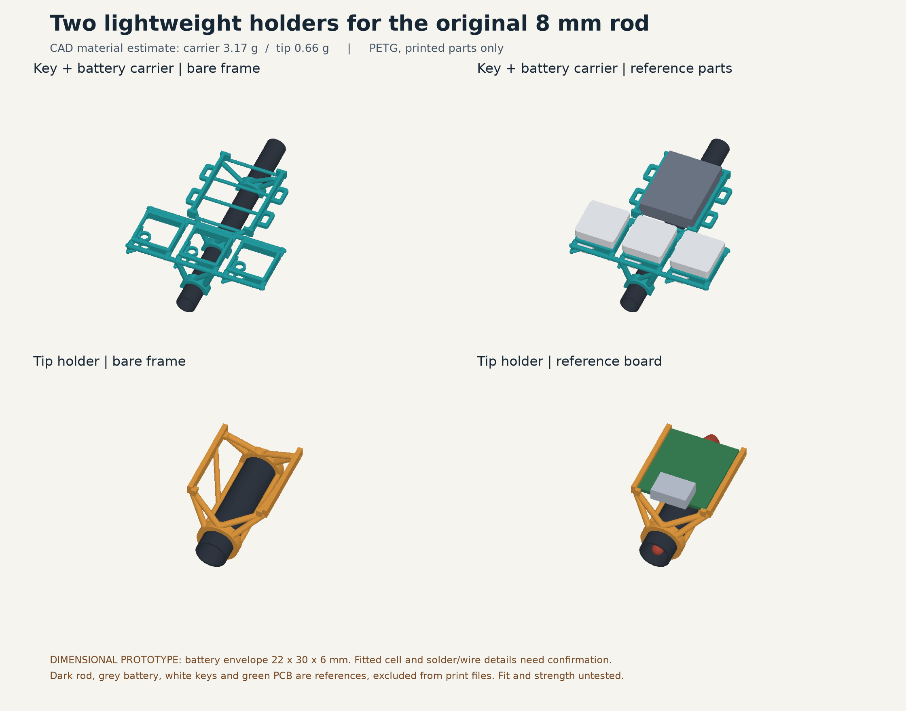

# Carbon-rod holders R2: USB towards the near sleeve opening

This revision keeps the accepted 28.4 mm tip-holder length and open frame. USB now points towards the near circular sleeve opening (-Y in the CAD), reversed from R1. The three-key and battery carrier has identical STL bytes to R1. Earlier sources and deliveries remain preserved.



## Close to the rod, with space for the leads

The PCB underside stays 8.8 mm from the rod axis: 4.8 mm above the bare 8 mm tube and 3.4 mm above the sleeve crown. This allows a **provisional 3 mm wire bundle plus 0.2 mm clearance on each side** above the sleeve. Lowering the board further would consume that allowance. Actual solder, insulation and wire dimensions remain unmeasured.

The red reference bundle runs below the PCB, around the open upper tube end and down the 7 mm bore. A small clearance cut removes only the intersecting brace material; both sleeve rings remain. The reference rod is now genuinely hollow, including in the assembly GLB. Red wires, the green board, silver USB, carbon tube, keys and battery are reference parts excluded from the print projects.

USB plug approach is checked from the newly exposed near end. The holder slides axially over a free tube end; use soft retention tape around the board/frame. The key/battery carrier lowers onto the rod and can be taped or glued at its saddles. Conductive carbon fibre still needs insulation from exposed electronics. The frame is not an insulating enclosure.

## Prototype limits

The battery remains a provisional **22 × 30 × 6 mm** complete insulated envelope, with 0.8 mm additional clearance per side. The nominal board footprint is **21 × 17.8 mm**. Verify the fitted cell, board revision, solder and lead exit before final printing. Physical fit, retention, bridge quality and strength remain unverified.

The P1S PETG recipe composes R1: 0.4 mm nozzle, 0.2 mm layers, three walls, 20% infill, supports off; no brim on the carrier and a removable outer brim on the tip. Bambu's existing carrier unsupported-region warning is preserved. The independent audit checks prepared normal meshes, floating starts and actual straight/arc extrusion in the rod, battery, switch, board, solder, USB and wire spaces. It is geometric evidence, not a print-strength simulation.

## Sources and rebuild

`parameters.json` owns the R2 dimensions and nominal wire centreline. `cad.py` composes the preserved R1 CAD and its existing Choc switch seats; R2 does not maintain another copy of those interfaces. The checker, slicer and mass scripts reuse their existing implementations and add the reversed USB and full wire-route checks.

From this directory, using an environment installed from `requirements.txt`:

```sh
python cad.py
python verify_and_render.py
python print_project.py --scratch /path/to/verified/scratch --slice
python verify_slice.py
python measure_mass.py
```

`exports/` contains the two print STLs, their common-coordinate assembly STLs, unsliced and checked sliced 3MF projects, assembly GLB, preview and hash/check receipts. The project contains exactly one carrier and one tip holder, not a complete replacement wand. `package_release.py --out /chosen/delivery/R2` derives a portable ZIP from those sources and checked files. In that ZIP, `exports/` holds the checked delivery; `source/hardware/carbon-rod-holders-r2/` is the rebuild location with the necessary preserved dependencies beside it. Regenerate rather than hand-editing an STL or receipt.
