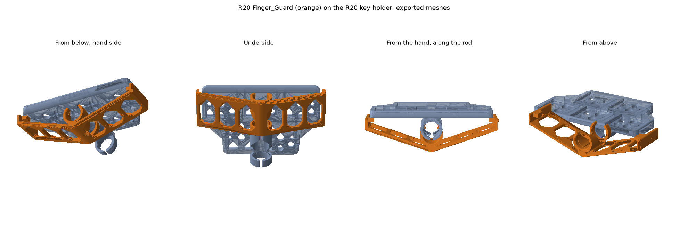
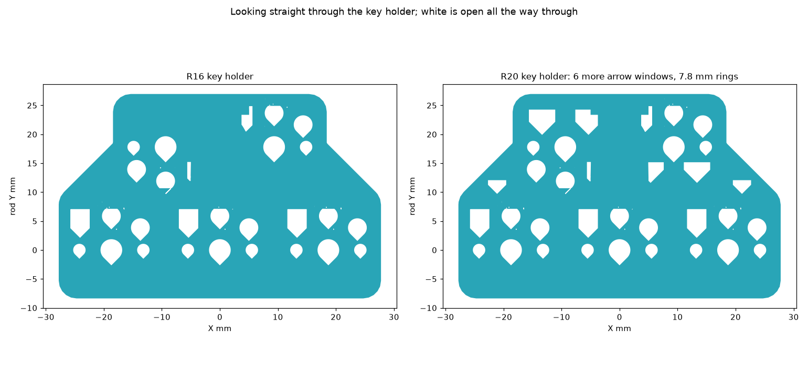
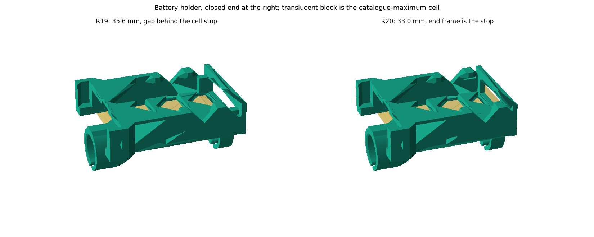
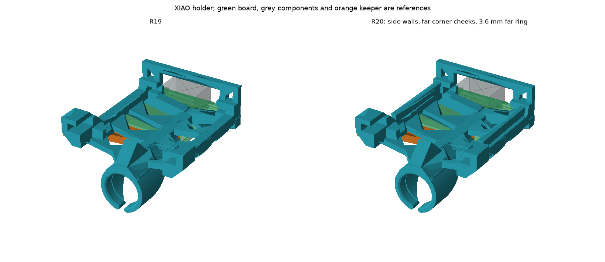

# R20: finger guard, and three holders revised from use

R20 answers what Ethan reported after fitting R19: his index finger rests on the
socket metal under the keys, the XIAO holder is flat and wide with nothing beside
the board, one XIAO rod ring looks short, the battery holder runs on past the
cell, the key holder twists when a side key is pressed, and the key holder looks
heavier than it needs to be. R16 to R19 and their exports are unchanged.

**Status: prepared for a controlled prototype fit trial; not printed. The revised
meshes, actual toolpaths, member checks, reload/re-slice and modelled guard
slide-on checks pass. The independent Opus 5.5 follow-up found no remaining
blocker (see [the audit](AUDIT.md)). Fit, grip, comfort, strength and cleanup
remain unverified until a physical trial.**

## What is on the plate

| Part | Change | CAD solid, before to after |
|---|---|---|
| `Finger_Guard` | New, removable | 1.661 g added |
| `Key_Carrier` | Rings 7.8 mm instead of 7.9 mm; 6 more arrow windows | 5.196 to 5.080 g |
| `Battery_Holder` | Closed end 2.6 mm shorter | 2.599 to 2.478 g |
| `XIAO_Rod_Holder` | Side walls, two corner cheeks, far ring 3.6 mm instead of 2.4 mm | 1.928 to 2.074 g |

The three revised parts together lose 0.091 g. With the guard the installed
assembly gains 1.570 g. The guard adds 1.661 g beneath the keys and the XIAO
holder adds 0.146 g at the board; the other two holders lose mass. These are CAD
solid figures at 1.27 g/cm3; earlier parts sliced at about 0.90 to 0.93 of that.
The battery door, XIAO keeper and cell spacers are the R19 parts and are not
reprinted. Full numbers are in [the geometry checks](exports/geometry-checks.json).

## Finger guard

The exposed metal under the keys is the hot-swap socket terminals and their
solder and wire connections. The guard separates the index finger from those
connections.

It follows Ethan's idea of a triangle from the key holder's outer edges to the
far side of the rod, with two differences he should know. It is a separate
slide-on basket, not beams joined to the key holder (reason below). And in each
wing only the front and rear rims run from the edge down to the keel; the two
rails between them run along the rod, because a beam across the wing would print
as a 26 mm bridge. Both rims are 1.8 mm, and every rail, keel and edge root at
the rear rim has a 45-degree gusset like the front gables. The windows are
arrow-headed like the R19 holders. It sits under the three lower keys,
where the index finger rests, 3.5 mm below the rod surface at its lowest and
2.2 mm wider than the key holder on each side.

**It is a separate part, not joined to the key holder.** Every socket loads
straight up from below, is then taped, and is backed with a finger or tool while
its switch is pressed in. Beams joined to the key holder would cross those routes;
the lower-left and upper-left socket routes are only 1.3 mm apart, so no beam fits
between them. A separate guard also fits the R16 key holder already on the wand.

- **Fitting:** clear the hand-end approach on the rod; other modules in that
  route may need to slide off first. The keys can stay wired in their holder.
  Slide the guard on with its open side toward the keys, until it stops against
  the key holder's middle ring and its front is flush with the holder's front.
  Slide it back off to reach the sockets. The checked route is the final 19 mm
  beside the key holder; it does not include other modules elsewhere on the rod.
- **Holding:** two spring rings of the same profile as every other holder, crown
  down on the keel. Their opening faces the keys and is 90 degrees wide instead
  of 30, so a wire crossing over the rod is left alone. The rings never touch the
  wings.
- **Under load:** a small pad under each front corner sits 0.3 mm below the plain
  underside of the key holder's nose. A pressed wing closes that gap and bears
  there. The guard can twist 0.6 degrees before a pad bears.
- **Edges:** every rail and rim edge is rounded 0.4 mm; the front rim, where the
  finger meets it, 1.0 mm outside. Tear-off pads sit inside the V, so no tie stub
  is left on a face a finger touches.

**Check on the built wand before printing.** These are assumed, not measured:

- Any wire crossing over the rod under the lower keys lies on top of the rod,
  within about 2.3 mm of its centre line, and nothing runs along the rod's sides
  there.
- Solder and wire at the right-hand lower key's outer terminal, which is at the
  very edge of the key holder, stay within 0.6 mm past that edge and 1.5 mm below
  the terminal.
- Tape and wire hang no more than 1.2 mm below any lower-row socket body.

**What it does not cover.** The two upper keys sit forward of the guard. A rigid
10 mm ball pushed in from the tip side, behind the guard, comes within 1.0 mm of
the assumed solder allowance; 12 to 16 mm balls stay 1.3 to 2.2 mm away. On the
bare key holder the same balls touch. A fingertip is soft and is not a ball.

## Key holder

**Thickness.** The 3.85 mm cannot come down where a key sits: the Choc switch
needs a 1.2 mm plate whose top is 2.2 mm above the board its housing rests on, and
its socket is made for a 1.6 mm board. Away from the sockets that board level was
already 1.2 mm with one window per key.

**Holes.** R20 adds two arrow windows under each of the two upper switch fronts
and one in each shoulder, each with at least 1.2 mm of plastic around it. That
and the ring change remove 0.116 g, about 2 percent. The three lower keys get
none: six windows there all fell in the same eleven print layers and cut that
layer from about 91 to 61 mm2, at the board level where the R15 key holder snapped, so
they were removed. The lower row's board level is now exactly R16's, and the
part's weakest layer is R16's own (63.7 mm2). The remaining cuts sit in three
separate bands up the print; the worst leaves 84 percent of R16's section, where
that section is 131 mm2. Larger windows would need new 12 to 15 mm flat bridges. The saddle and rings carry the
twist from the side keys and stay solid.

**Grip.** Only this part's two rings change: relaxed bore 7.8 mm instead of
7.9 mm on the 8 mm rod, which doubles the nominal squeeze from 0.1 to 0.2 mm on
diameter. Wall, width, opening and lead-in are R16's, and every other holder keeps
7.9 mm. It is intended to grip more firmly; actual slide force and friction are unmeasured;
the R16 key holder remains the fallback.

Reprinting it means moving five wired keys. The guard does not need it.

## Battery holder

In R19 the cell stopped on two small corner blocks, then came 2.6 mm of empty gap,
then the end frame. That gap existed only so the far rod ring could sit wholly
behind the cell. The ring's crown is in the floor, so it now sits under the cell
end, and the end frame's own side posts are the stop at the same place and the
same contact width. The holder is 33.0 mm long instead of 35.6 mm. Cell bay,
retaining teeth, door end, floor and both ring sections are unchanged.

The closed end was identified from Ethan's phone photo. No dimension was taken
from the photo.

## XIAO holder

- **Side walls.** Each rail now carries a wall beside all seven pad rows, 1.15 mm
  above the board top and 1.11 mm from the board edge, which is the existing room
  for castellation solder. The board sits 2.4 mm deep between them. Wires leave
  the pads upward and pass over the wall.
- **Corner cheeks.** At the two bare USB-end corners, beyond the last pad, a
  cheek stands 0.31 mm from the board edge. In R19 that end could swing out to
  the rails, 1.11 mm away. The near corners keep their 0.3 mm V stops.
- **Far ring.** 3.6 mm along the rod instead of 2.4 mm, the width of the battery
  holder's rings. Bore, wall and opening are unchanged, and the extra 1.2 mm is
  carried by the keel only, so it is not made rigid.

Nothing is removed from the R19 part. The keeper, hoop, posts, ledges, USB and
reset access are the R19 geometry, and the R19 keeper is reused.

**Why the two rings look different.** The holder prints standing on its USB end.
The far ring starts on the bed, so it is a plain band. The near ring is at the top
of the print with nothing under it, so each arm grows from a 45-degree lead-in:
that is the triangular part. The lead-in is permanent and stiffens that ring.

## Print

A1 mini, 0.4 mm nozzle, textured PEI, Generic PETG, 255 C / 70 C, 0.2 mm layers,
3 walls, 20 percent infill, 0.6 mm Normal lift, no support. The component recipe is R19's.
Open [the layout](exports/R20-A1-mini-PETG-layout.3mf); the
[offline slice](exports/R20-A1-mini-PETG.gcode.3mf) is the audited one: about
79 minutes and 12.7 g including pads and the timelapse tower. Do not save over it in Studio.

**Timelapse: Smooth, with a wipe tower.** Traditional mode raised the A1 mini's
`not_support_traditional_timelapse` warning on these thin parts. Smooth mode with
an actual tower removes that warning. The little tower in the empty front area
is a disposable place for the nozzle to wipe during capture, not a wand part.
Its actual bead footprint is inside the plate and over 39 mm from every holder
and pad. Keep Timelapse ON in the send dialog too; the file setting does not
verify the printer's recording switch or that a playable recording was saved.

**No slicer brim.** A brim would run into the open rod rings. Every object has
labelled tear-off pads instead: 0.4 mm thick, on 1.0 x 0.4 mm ties, the R19
recipe. Battery and XIAO pads are identical to R19's. The key holder has four on
its tip edge. The guard has four inside the V, each tie at the middle of a window bay on the
rear rim, away from the rail roots.

All four print with the rod axis vertical, as every ring here does. The guard
stands on its rear face; its rounded finger edge is the last layer. The slice
keeps the R16 slow bands on the key holder and the R19 one on the battery holder,
moved down 2.6 mm.

The slice is built with `project19.py`'s resolver and command audit: the A1 mini
include templates are resolved, and the archive is rejected unless the commands
that actually run wait for 255 C and 70 C before the first object and switch both
heaters off at the end.

## Cleanup

Let the plate cool and flex it. **Snip every guard tie; do not peel.** They attach
to the thin rear rim. Snip the XIAO hoop-top ties as before. Never lever on a ring, a
rail or a wing. Deburr the guard's bed edges lightly; that end faces the tip.

## Reproduce

Run each through the repository geometry runner, in order: `holder20.py`,
`anchors20.py`, `verify20.py`, `members20.py`, `project20.py --slice --scratch <scratch>`,
`slice20.py`, `roundtrip20.py --scratch <scratch>`, `guard_paths20.py`, then
`guard_paths20.py --project <scratch>/roundtrip/out/resliced.gcode.3mf --report exports/guard-path-roundtrip-checks.json`,
and `views20.py`. Regressions:
`<cad-python> -B -m unittest discover -s magic-wand/hardware/carbon-rod-holders-r20-finger-guard -p test_holder20.py -v`.

Evidence and open items are in [the audit](AUDIT.md).
