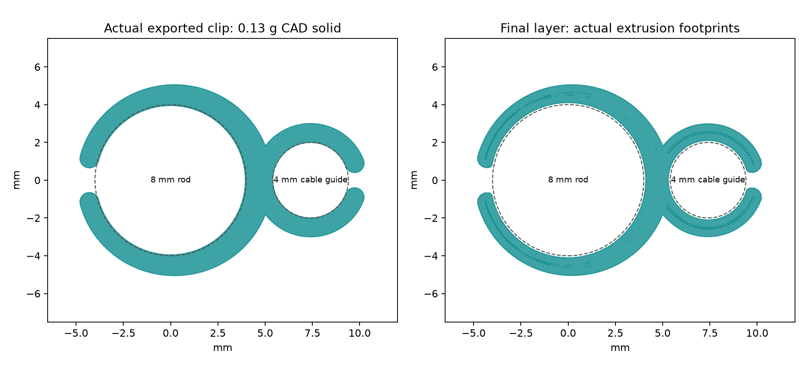

# R21 split figure-of-eight cable clip

A separate, light guide for the cables between the XIAO board and battery.
The larger open loop goes around the 8 mm rod; the smaller open loop gathers
the cables. Neither requires threading the cable connector through a closed
hole. This is a later print: R20 and its active four-part job are unchanged.

**Status: digitally checked for a controlled prototype trial; not printed or
sent. Physical fit, insertion force, retention, pad release and fatigue are
unverified.**

## Size and mass

- Approximately 15.0 × 10.1 mm, and 2.4 mm along the rod.
- CAD solid mass: 0.130 g in PETG at 1.27 g/cm3, excluding removable pads/tower.
- Rod loop: the earlier R7 7.9 mm spring bore, 1.0 mm tip wall and 1.4 mm root,
  with the opening facing away from the cables. Its actual grip is unmeasured.
- Cable loop: 4.0 mm nominal bore, 1.0 mm wall, rounded tips and a 0.8 mm entry
  slit. Both bore mouths have a 0.2 mm lead-in to avoid a sharp insulation edge.
- The two loops share their fixed waist. They print flat, with continuous
  paths around each spring, rather than standing on a narrow edge.

The 4 mm cable guide is a loose prototype allowance based on the earlier
provisional 3 mm wire corridor. It is **not a measurement of the bought wires**.
Keep clearance around the actual bundle; do not squeeze insulation, pull on
solder joints or use this guide as strain relief. Change `cable_bore_mm` and
recheck if the real bundle does not fit freely. Do not force the battery leads.

## Print and cleanup

Use the [prepared layout](exports/R21-A1-mini-PETG-layout.3mf) or the
[checked slice](exports/R21-A1-mini-PETG.gcode.3mf): A1 mini, 0.4 mm nozzle,
textured PEI, Generic PETG, 255°C nozzle / 70°C bed, 0.2 mm layers, three walls
and 0.6 mm Normal lift. The checked estimate is 8 minutes 47 seconds and 0.33 g
including two tiny adhesion pads and the separate Smooth-timelapse wipe tower.
The tower is disposable; enable Timelapse in the actual Send dialog as well.

No automatic support or slicer brim enters either loop or slit. Two 0.4 mm
bed pads attach to the fixed waist through 0.7 mm ties. After cooling, **snip
both ties in the empty space halfway to each pad, around Y ±3.7 mm in the
source view**. Do not peel the pads against a spring arm. This leaves a small
bed-layer stub outside the arm near its root; trim the stub lightly, without
cutting into the arm. Deburr bed edges. Pad removal and adhesion need a real trial.

Slide the rod loop on **from a free rod end only**. Do not spread its small
opening over the full rod; slide another holder off first if necessary.
Put the cables through the smaller opening
gently, one at a time. Keep both openings clear and inspect for cracks. The
clip is removable and contains no latch, screw, glue or extra backplate.

## Checks and reproduction

The [audit](AUDIT.md) identifies the final archive, its actual beads, openings,
pad connections, reload/re-slice and review result. These are digital checks,
not a promise that every print or physical fit succeeds.

Run through the repository geometry runner, serially: `clip21.py`,
`project21.py --scratch <verified-SD-scratch>`, `check21.py`, then
`roundtrip21.py --scratch <verified-SD-scratch>`.
`test_commands21.py` exercises the real single-object file and rejects unsafe
temperature-wait changes. This one-object audit uses the first non-custom
extrusion feature because Studio omits object-cancellation comments on a
single-object plate; the exact executable code is not patched.
