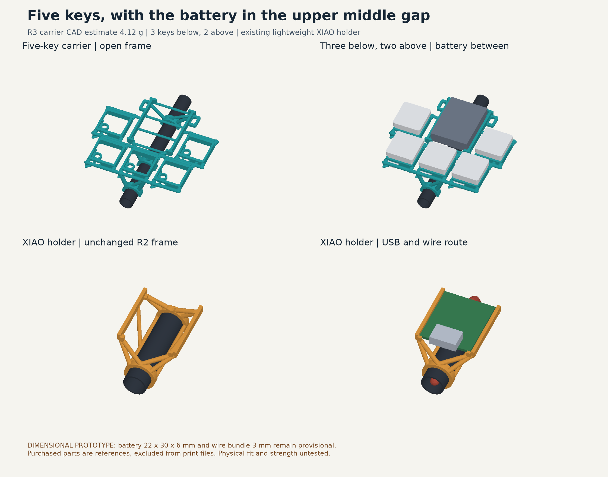

# Carbon-rod holders R3: five keys and battery

Two lightweight accessories for the original 8 mm outside / 7 mm inside carbon tube. The new carrier has three keys in the bottom row and two above at the sides. The battery sits above the middle bottom key, between the upper keys. The small XIAO holder keeps the R2 geometry, including its near-end USB access and wire route beneath the PCB into the tube. Earlier revisions remain unchanged.



## Dimensions and material

- Bottom switch centres: x = -20, 0, 20 mm; y = 0.
- Upper switch centres: x = -25, 25 mm; y = 22 mm. The wider upper gap fits the nominal battery without moving the existing bottom seats.
- Carrier outside bounds: 69.1 × 60.4 × 14.1 mm. Use tape or glue at the open rod saddles; battery tape passes through the outer loops.
- Battery remains a **provisional 22 × 30 × 6 mm insulated envelope**, with 0.8 mm clearance per side. Actual cell, solder and lead exits must be measured.
- XIAO holder: 21.2 × 28.4 × 15.4 mm overall; board underside 8.8 mm from tube axis. The provisional 3 mm wire bundle routes below the PCB, over the open tube end and into the bore. USB faces the near sleeve opening (-Y).
- Slicer estimates: carrier **3.739 g**, XIAO holder **0.595 g**, model plastic **4.334 g**; removable brim **0.105 g**; total slicer estimate **4.53 g**. These are not weighed parts.

The open frame uses the bought Choc V1 switch's clips and the preserved socket/pin clearances. Keys, battery, board, wires and tube are reference parts, excluded from the print files. The XIAO STL is byte-identical to R2. A complete project here means one carrier and one sensor holder, not a complete replacement wand.

## Checked and still unverified

Final STLs are closed, single-component normal meshes. Checks cover all five switch entries, factory-clip capture, bought-part separation, battery/rod/board/wire/USB spaces, prepared 3MF geometry, and actual sampled model/support extrusion. The independent layer-start audit found no floating starts under its documented numerical limits.

Bambu still reports the inherited carrier floating-region warning. A passed independent geometric audit does not establish bridge quality or printed strength. Battery fit, solder clearance, purchased keycap underside/full travel, retention and strength remain physically unverified. The cap models are illustrative external envelopes, not measured full-travel models. Insulate exposed electronics from conductive carbon fibre. The open holder is not an insulating enclosure.

The preserved P1S PETG recipe uses a 0.4 mm nozzle, 0.2 mm layers, three walls, 20% infill and supports off. Carrier has no brim; tip has a removable 3 mm outer brim. Test-print and fit-check before use.

## Interactive review and rebuild

Serve the repository root with a local HTTP server, then visit `magic-wand/hardware/carbon-rod-holders-r3/preview/`. The viewer loads the actual exported meshes, can hide references or isolate either holder, and compares R3 with the previous three-key R2. Turn, move and zoom reuse the existing immediate-input viewer controls. No receiver, firmware or installed settings change.

`parameters.json` owns only the R3 overrides. `cad.py` composes the preserved R2 sensor and R1 seats rather than maintaining another switch-interface copy. From this directory, with the pinned `requirements.txt` environment:

```sh
python cad.py
python verify_and_render.py
python print_project.py --scratch /path/to/verified/scratch --slice
python verify_slice.py
python measure_mass.py
python build_preview.py
python package_release.py --out /chosen/delivery/R3
```

Slicing requires installed Bambu Studio on macOS. Use your configured scratch-disk policy. Keep the checked exports and source dependencies together. The ZIP contains ready-to-print exports plus editable sources under `source/`; rebuild from `source/magic-wand/hardware/carbon-rod-holders-r3/`. Serve `source/` to use its interactive preview. Generated meshes and receipts must be regenerated, not hand-edited.
