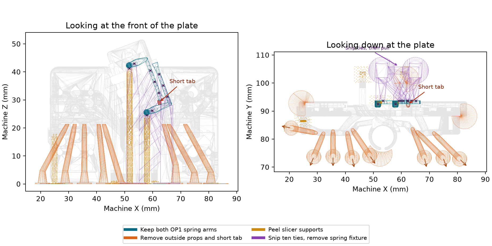
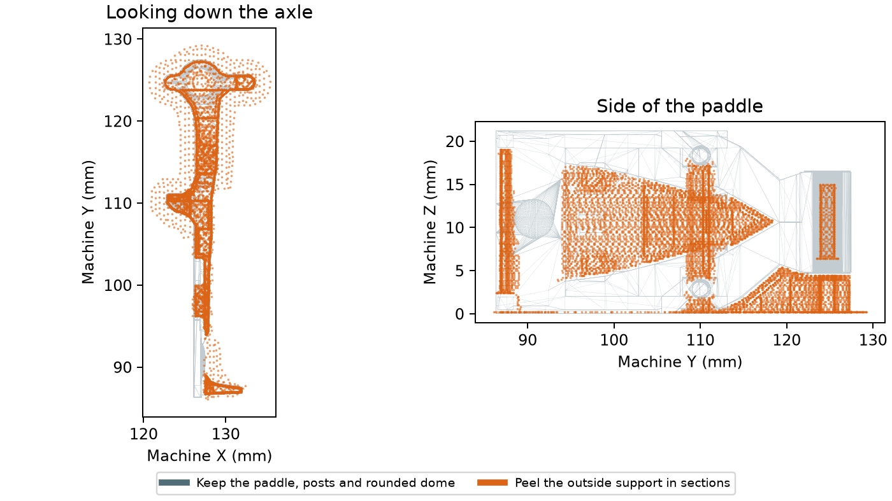

# Key carrier and paddle

The two-object A1 mini plate uses the frozen assembly STLs, PETG and a 0.4 mm nozzle. Bambu Studio estimates 2 h 38 min and 19.72 g. Keep the carrier, including its two narrow OP1 spring arms, and the paddle, including its posts and rounded underside. All four square key wells are open.

## After the plate cools

1. The purple two-post frame steadies the two blue OP1 springs during printing. Hold the carrier at the rigid rim. With fine flush cutters, snip the five narrow ties to each spring, including the small tie below each nose. Lift the freed frame straight away from the board seat toward the backs of the two purple posts. Trim any small remaining nub flush with the spring.
2. On the carrier, peel the four thin exterior adhesion discs away at bed level. The four square key holes do not need digging out.
3. Working left to right as shown in the top-down map, grip each of the eight orange outside props by its broad foot. Pull it outward in the indicated direction. Each has a checked 90 mm straight withdrawal after the earlier props are out.
4. A single **short disposable tab** meets the fixed shoulder near the right-hand spring root. Hold the carrier at the fixed shoulder. Cut the 1.36 mm³ tab joint flush with the fixed shoulder, then pull the loose tab toward the back left in the top-down map. Keep both long blue spring arms and their locating pegs.
5. Peel the remaining thin support from the outside in small sections. On the paddle, peel from the outside edges of the hinge lands and the underside. The two DFRobot posts, rounded click dome and axle opening belong to the paddle. The axle opening is clear of deposited support.
6. Install the OP1 board and hardware after cleanup. Check both spring arms lift and return, the four switches enter their seats, the rod clips on, and the paddle clicks from both corners on the cooled physical parts.

## What the native paths establish

- Both objects have continuous layer starts. Shallow bevels under three narrow retaining lands divide each key opening’s printed roof into short sections. All four mounting holes, seated switches and nominal and maximum socket bodies are clear with the supports present. Removable exterior prop material enters the travel space of key 2’s cap. Finish removing the props before fitting or pressing that cap.
- The upper-left socket slides through an exterior approach occupied by detachable props and peel-away support during printing. Every checked permanent path clears the nominal, maximum-size and soldered socket loading routes after cleanup. The largest route uses 41 poses. [Socket paths](exports/print-mechanisms/sockets.json)
- The paddle has a conservative 3.068 mm through bore for the 3 mm sleeve. The carrier M2 axle opening measures 2.096 mm at its tightest sampled section. The modeled underside lead, finger-contact faces and axle cores have zero support bead samples. [Native geometry](exports/print-mechanisms/roofs.json)
- The removable two-post frame crosses the open approach above the OP1 outlet. All 7,236 projected samples lie on that frame. Its nearest bead is at least 4.83 mm above the carrier wall around the outlet. The enclosed passage is clear even during printing. Remove the frame before lowering the plugged-in board. [Wire passage and fixture](exports/print-mechanisms/op1-wire-passage.json)
- The carrier adds 208.39 mm² of bed ears around its roughly 330 mm² footprint. The ear paths remain at least 5.477 mm from the rod axis. The relaxed rod grips are intentionally spring-loaded. [Rod-path comparison](exports/print-mechanisms/rod-passage.json)
- The two spring arms have 1.08 mm of modeled lift with zero fixed-wall violations across 13 native-path check positions per arm. The sliced gaps beside the moving arms measure at least 0.63 and 0.68 mm. All ten frame ties have overlapping printed beads. After cutting the ties, the frame clears the carrier along a 60 mm outward pull. [Spring fixture](exports/print-mechanisms/op1-spring-fixture.json)
- A 0.8 mm support fragment can reach the exterior from every sampled support location on both parts, checked on a 0.2 mm carrier grid and a 0.1 mm paddle grid. Intact separation force, spring life and click return need a physical print. [Spring paths](exports/print-mechanisms/spring-paths.json) · [Support removal](exports/print-mechanisms/removal.json)

The previous process carried beads 13–14 mm across three openings. Both lower keys now measure 2.48 mm across the largest flagged path footprint. The upper-right measures 2.83 mm. The upper-left went from 1.62 to 2.64 mm in the same check. The longest extrusion path loops back on itself over 6.35 mm within a 2.40 mm footprint and has one supported end. A cooled physical print is needed to measure actual droop. Dry-fit the four switches before installing the OP1 board. Each should seat flat and release without scraping a roof. [Before and after at each key opening](exports/print-mechanisms/roof-improvement.json) · [Retained bearing surface](exports/key-bearing.json)

Generate the editable plate with `mechanisms52.py OUTPUT` after `build52.py`. Use the established `slice45.py` on the editable project. `roofs52.py`, `sockets52.py`, `removal52.py` and `flex52.py` check the selected native machine paths. [Editable plate](exports/print-mechanisms/layout.3mf) · [Native slice](exports/print-mechanisms/Mechanisms.gcode.3mf) · [Independent layout reproduction](exports/print-mechanisms/layout-reproduction.json)
