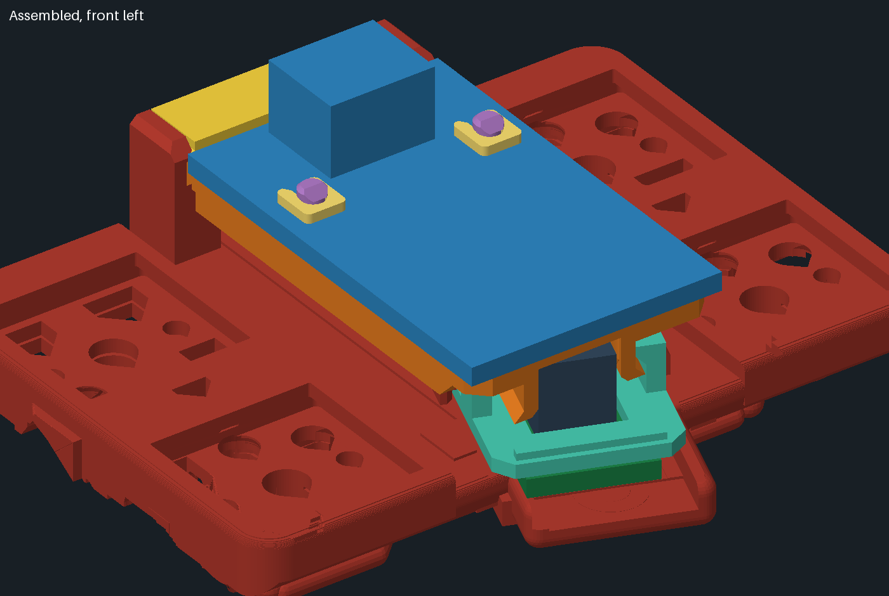
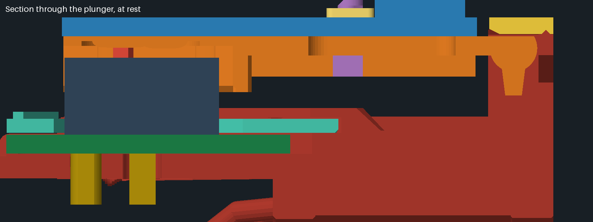

# R53 guided OP1 click and printed hinge

R53 replaces the OP1 seat, the touch paddle and its hinge on the carbon-rod Magic Wand mouse. The four outer switches retain the R52 spacing. The underside has sloped edges so their insertion paths can print open. Physical fit is pending.

## What changed from R52

| R52 on the bench | R53 |
| --- | --- |
| The OP1 pocket was too wide and the board wandered | The centre returns to R51's fitted pocket. Two tapered fingers enter the board eyelets from below as the board drops in. A separate sliding lid holds it down. |
| The paddle missed the switch | The paddle carries a three-sided sleeve that fits round the switch body at its 20.5° angle. Two rounded contact faces cover the plunger in either switch orientation. Each has a 4.8 mm shoulder and a tip more than 3 mm wide in the slice. |
| Sideways wobble | The axle bar runs in two V seats 17 mm apart (R52's bearings were 10 mm apart) and the sleeve guides the front on the switch. |
| Hinge holes filled with strings | No hinge bores. The paddle has a printed D-shaped axle bar that drops into open seats. A printed cap closes them. |
| Supports and props that had to be cut off | The locating fingers are built into the pocket floor. The seven finished parts each sit on their own wide peel-away base. |
| Stop horns above the board | The yoke and cap finish level with the touch board. |

## Printed bodies

Print each body as its own piece. The print poses and their transforms are in [print-spec.json](exports/print-spec.json).

| Body | Job | Bed face | Support |
| --- | --- | --- | --- |
| [Key_Carrier](exports/Key_Carrier-assembly.stl) | Key holder with the hinge yoke, lid rails and OP1 pocket | Rear face, as R52 | Support disabled on the production plate. |
| [Touch_Paddle](exports/Touch_Paddle-assembly.stl) | Carries the touch board, presses the switch | Flat top | None |
| [Hinge_Cap](exports/Hinge_Cap-assembly.stl) | Holds the axle bar in its seats | Flat top | None |
| [OP1_Lid](exports/OP1_Lid-assembly.stl) | Holds the OP1 board down and stops the paddle lifting | Flat underside | None |
| [DFR_Post_Bar](exports/DFR_Post_Bar-assembly.stl) | Two posts for the touch board, fitted from below | Flat back of bar | None |
| [OP1_Lid_Close](exports/OP1_Lid_Close-assembly.stl) (optional) | Same lid with a smaller lift gap, marked with two ribs | Flat underside | None |

[Tray map](exports/print-mechanisms/tray.png) · [Checked printer file](exports/print-mechanisms/R53-Guided-OP1-and-Hinge-print-only.3mf)

The plate includes a separate left and right retaining clip, one for each post. The M2 axle screw, locknut, metal sleeve and the two small kit screws are no longer needed.

## Assembly

1. Plug the lead into the OP1 board. Feed the lead through the holder. Lower the board flat until its two mounting holes settle over the tapered fingers.
2. Push the switch into the three sockets. It fits either way round and the paddle has a crown for both.
3. Away from the holder, push the post bar up through the two holes in the paddle. Lower the touch board over the posts and slide a clip onto each neck.
4. Lower the paddle straight down. The sleeve goes over the switch and the axle bar drops into the two seats.
5. Push the hinge cap forward along the top of the yoke until it clicks and sits flush with the rear face.
6. Slide the lid in from the front, along the board, until its latch clicks.
7. Press the centre and both lower corners. Each press should click once and spring back.

To take it apart, pull the lid out forwards, drag the cap rearwards with a fingernail, then lift the paddle.

A closer-fitting lid with two ribs is available as a separate model if the standard lid leaves too much vertical play. The standard lid is on this plate. If the switch stays pressed with either lid, leave the lid out and tell me how high the paddle sits.

## What positions the click

The switch body is the reference, because its size and button position come from the Omron drawing. The switch body guides the paddle. Two flexible noses in the floor locate the board using eyelet positions estimated from the kit photos. The pocket has 0.45 mm of nominal side clearance to let the eyelets find their pins. The paddle rests on the button, and pressing stops when the crown reaches the switch case. No fixed stop on the holder limits the click.

## Checks

[mechanical-fit.json](exports/mechanical-fit.json) records the CAD checks against the same hardware references as R52. The board, switch, paddle, cap, lid and post bar each travel their whole fitting route without touching anything. The paddle clears every fixed part along its hinge arc, from the lid stop to the switch case. The actual sliced paths were checked across all seven pieces for support material and starts with no layer beneath them. The key switch, flange, socket and lead paths are recorded in [the key checks](exports/print-mechanisms/keys.json). The hinge and board fitting paths are recorded in [the mechanism checks](exports/print-mechanisms/fit.json).

These are geometric checks. Click feel, spring-back, printed fits, the lid latch and the cap latch need a printed trial. [Mechanical notes](mechanical-notes.md) gives the dimensions, the reasoning and the open questions.

## Editable sources

Run each script in a fresh process through the repository's guarded geometry runner with the Wand CAD environment.

1. `build53.py` writes the assembly meshes and `dimensions.json`.
2. `checks53.py` writes `mechanical-fit.json`.
3. `print53.py` writes the print poses and `print-spec.json`.
4. `transforms53.py` writes [assembly-transforms.json](exports/assembly-transforms.json) for the viewer and the plate.
5. `render53.py` writes the pictures in `exports/review`.

The production plate is generated by `plate53.py` from these bodies and the original DFRobot clip meshes. Slice the editable layout with Bambu Studio using its saved A1 mini profile. The plate checks in `verify_plate53.py`, `layers53.py`, `contacts53.py`, `openings53.py`, `mating53.py` and `bridge53.py` use actual deposited paths. Reopen and slice the editable project again before running `release53.py`, which preserves the reviewed printer instructions byte for byte. The separate timelapse tower sits on its own reinforced base. Discard it with the seven removable bases after printing.
