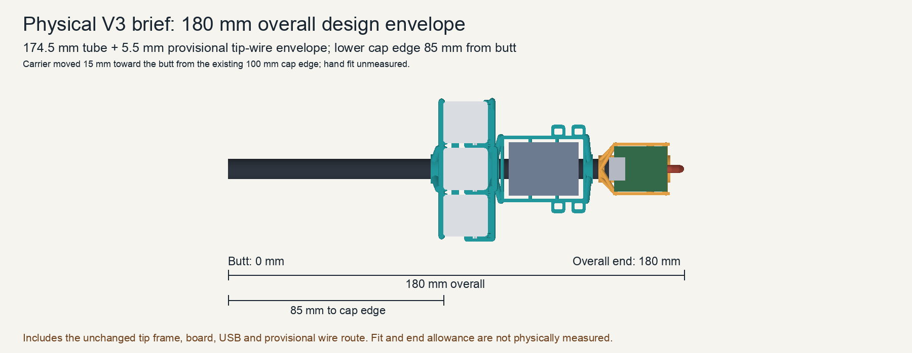
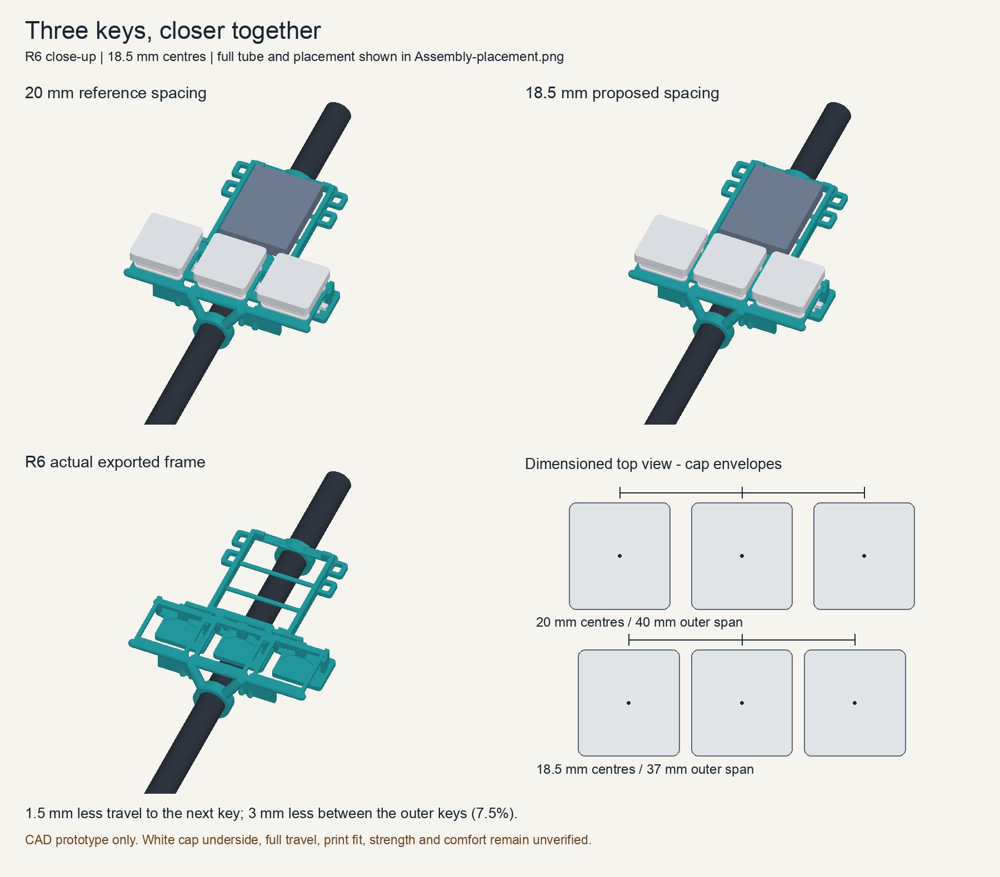

# Carbon-tube holders R6 - three closer keys

Exactly three Choc V1 keys in the original straight row across the carbon tube,
with one front battery cradle. Centres are **18.5 mm apart**, reduced from the
20 mm R2 spacing. The middle key stays centred; each outer key moves inward
1.5 mm. Adjacent travel falls 7.5%, and the outer-centre span falls from 40 to
37 mm. These are calculated distances, not measured comfort results.

## Physical V3 brief and proposed placement

Ethan's **V3** here means the new physical prototype brief, not firmware
Control V3 or the older holder R3. His latest selection for the next prototype
is **18 cm overall**, not a claim of a mathematically optimal length.

The earlier key-cluster edge around 100 mm from the butt describes the existing
layout. At 180 mm overall, that location produces actual 3D intersections between
the carrier/battery and the tip frame, PCB and USB. Moving only to 90 mm still
intersects the carrier and tip frame. The proposed **85 mm lower cap edge** moves
the carrier **15 mm toward the butt** and leaves **2.05 mm between the printed
frames along the tube**, with no tested 3D intersections. Actual hand fit remains
unknown. The cap edge is the explicit modeling interpretation of "bottom of the
key cluster"; it is not a physical survey or a measured hand-pivot position.



The illustrative caps are 17.5 mm long along the tube, so their centres sit
93.75 mm from the butt. The printed carrier itself starts about 79.95 mm
from the butt; its lower ring extends below the caps. In the GLB, the butt is
Y=0, the tube tip is Y=174.5 and the provisional wire envelope ends at Y=180.
The print STLs retain their existing carrier-local
coordinates; `carrier_local_to_reference` in the manifest supplies the 93.75 mm
translation for the assembly view.

The **tube is 174.5 mm long**. The remaining **5.5 mm** is the positive tip
overhang of R2's provisional 3 mm wire-route envelope. R2 places the upper end
of the unchanged XIAO frame flush with the tube end; this reference preserves
that mounting relationship, plus its board, USB and wire geometry. The frame
origin is 151.1 mm from the butt. A bare 180 mm tube with those same references
would instead make a 185.5 mm overall design envelope. The PCB's bounds, actual
reference centre, and USB bounds are derived into `exports/manifest.json` under
`assembly_reference`; no separately copied board-centre constant is used.

This is a proposed assembled envelope, not a measured finished wand. Actual
wire bends, insulation and end fit must be checked before cutting the tube.
No grip pivot or centre of mass is assigned. The original R2 GLB and its source
are hashed dependencies of this derived placement.

## Closer key spacing



## Parts and preserved interfaces

`cad.py` composes the corrected switch seats, sourced switch/socket geometry,
closed sliding rings, and front battery cradle from [R4](../carbon-rod-holders-r4/README.md).
It includes no upper pair of keys or their redundant support rails. The XIAO
holder STLs are copied unchanged from R4/R2. R2, R4 and the concurrent five-key
R5 remain untouched.

The effective dimensions compose `parameters.json` over R4's canonical parameters.
The tube remains 8 mm OD / 7 mm ID; ring bore is 8.4 mm. The battery cradle
retains the provisional 30 x 22 x 6 mm reserve, with R4's extra side allowance.
No receiver, firmware or button mapping change is part of R6. The proposed
carrier translation does not assign an actual hand or wrist pivot.

| Dimension | 20 mm baseline | R6 |
|---|---:|---:|
| Adjacent centre distance | 20 mm | 18.5 mm |
| Outer centre span | 40 mm | 37 mm |
| Gap between 15 mm switch bodies | 5 mm | 3.5 mm |
| Material between 14.1 mm openings | 5.9 mm | 4.4 mm |
| Gap with the illustrative 16.6 mm cap width | 3.4 mm | 1.9 mm |
| Gap with a conservative 17.5 mm cap width | 2.5 mm | 1 mm |

`spacing-comparison.json` is generated from the same CAD parameters. The preview's
20 mm comparison uses the same corrected R4 interfaces, so it isolates spacing;
it is not a claim that the historical R2 seats have been corrected.

## Reference accuracy and licence

R4 owns the [KiSwitch source provenance](../carbon-rod-holders-r4/references/provenance.json)
and [CC BY-SA 4.0 licence with KiCad exception](../carbon-rod-holders-r4/references/LICENSE-CC-BY-SA.txt).
The pinned community source is [KiSwitch revision aefcf650](https://github.com/kiswitch/kiswitch/tree/aefcf65038d48d2666ff14530d482be3c350fa6e).
The switch/socket geometry and their derived reference meshes retain that
attribution and licence. They are not manufacturer-certified CAD of the fitted
parts. The exported GLB includes this attribution; the manifest hashes the
parent sources, source parameters, reference meshes and licence.

[Adafruit's white cap 5737](https://www.adafruit.com/product/5737) has no published
dimensions on its product page. The related [black cap 5111](https://www.adafruit.com/product/5111)
lists 17.5 x 16.6 x 5.2 mm. R4's 16.6 x 17.5 x 3 mm cap is an illustrative
external envelope only. Its underside, mounting height, side play and the actual
white cap dimensions remain unmeasured. The conservative 17.5 mm width leaves
1 mm nominal separation at R6 pitch. A tighter 17.5 mm pitch could leave no gap
with that orientation, so R6 does not adopt it.

## Verification and use

The geometry receipt checks the exported normal meshes, three switch/socket
interfaces, nominal and maximum-size socket loading routes, positive front-rail
joints, factory-clip capture, flange stops, full tube corridor, wire bus, battery
reserve, three complete bearing rings and a common print face. A continuous
3.3 mm swept envelope checks illustrative caps against the frame. It does not
establish the actual cap's underside or travel.

**Charging-lead access is unverified.** The model includes the USB connector
body, not the external cable's plug mould or lead bend. The frames have about
2.05 mm axial separation, and the USB body begins about 6.35 mm beyond the
carrier's end; neither distance proves a real plug will clear in 3D. The
carrier can slide, but that does not guarantee cable clearance. Test the actual
charging lead before treating USB access as verified.

The deliverables are `Key_Battery_Carrier.stl`, unchanged `XIAO_Rod_Holder.stl`,
their assembly-coordinate STLs and `Assembly-reference.glb`. Bought parts in the
GLB are references and are excluded from the print STLs.

**R6 has not been sliced or printed.** No new print recipe or Bambu project is
claimed. Apply the existing R4 PETG process when preparing a print, then inspect
its support removal and clearances. First use real parts to check the cap gaps,
independent full presses, socket fitting, wiring, ring alignment/drag, twist,
thumb reach and finger comfort. Do not use the LiPo pouch as a thumb support.

With Python 3.12 or later and the existing R4 dependencies installed, from this directory:

```sh
python cad.py
python verify_geometry.py
python render.py
```

For a placement-only update, `python cad.py --reference-only` regenerates the
GLB and manifest after checking the existing STL hashes. Then rerun
`python verify_geometry.py` and `python render.py`; the print meshes are preserved.

`requirements.txt` references the R4 dependency list. Source/export hashes in
`exports/manifest.json` make parent changes detectable; rebuild and recheck the
candidate if any dependency changes. Physical fit, strength and comfort remain
separate from these reproducible CAD checks.
