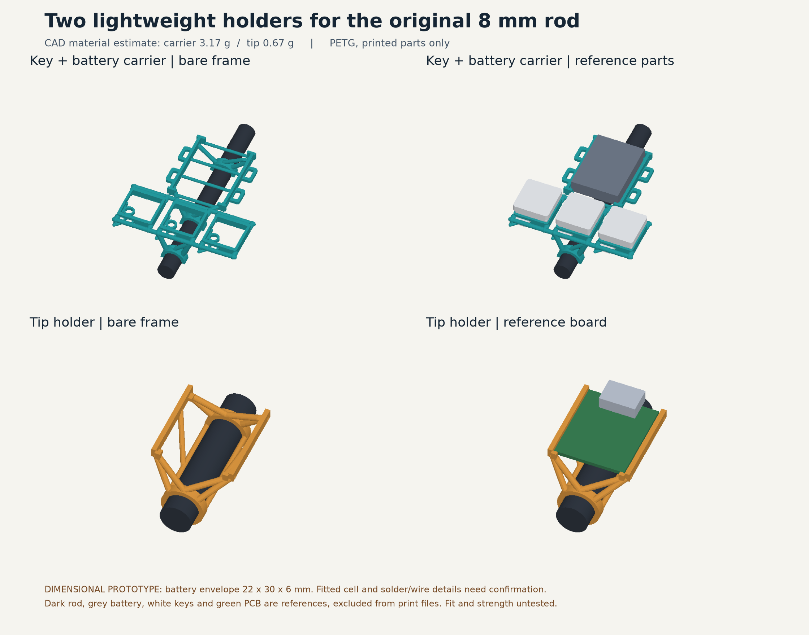

# Open-frame holders for the original carbon rod

Two one-piece accessories for the original 8 mm outside / 7 mm inside / 500 mm carbon-fibre tube. This is a dimensional prototype, not a physically accepted print. The previous Shard wand designs are unchanged.



## The two components

- **Key + battery carrier:** three integral Choc V1 seats horizontally across the rod, at 20 mm centres. The open battery ladder sits above the middle key along the rod. Three half-round saddles lower onto an already wired rod; narrow tape or a suitable adhesive holds the carrier in place. The frame shares key-press loads through two continuous cross rails. Bought switches use their own retaining clips; sockets sit on two locating pads and narrow ribs. No printed cap covers, separate switch plates or printed spring claws.
- **XIAO holder:** two short 8.4 mm bore sleeves, 1.2 mm walls, open sides and triangulated supports. Slide it over a free rod end. Four small edge ledges and split lower stops locate the board; soft tape retains it. USB faces towards the tip and stays exposed. This sleeve does not rely on an untested snap-fit or force the board against the carbon fibre.

Both components are symmetric across the rod; no handed grip or finger loop is part of this accessory pair. The assembly GLB includes a 500 mm reference rod. The carrier's position along that rod is illustrative; neither unit requires that placement.

## Fit boundary

The switch family is Kailh Choc V1 red, with compatible hot-swap sockets and milky-white slim caps. The seat and simplified hardware references compose the existing `printed-loop-wand/shard-tube-r2/direct_switches.py` geometry. Bought clip force, actual socket/solder revision and cap motion still need a physical check. Reference keycap shapes are illustrative; they are not printable covers or a measured cap-travel model.

The battery envelope is **provisional: 22 × 30 × 6 mm**, with 0.8 mm extra on each side. The actual fitted cell, insulation, connector and lead exit are unmeasured. Do not infer fit from battery capacity alone. Change `parameters.json` to match the complete insulated assembly before a final print. The battery is lifted outwards; there is no rigid lid or press-fit around a pouch cell. Retention tape should hold the frame without compressing the cell.

The nominal XIAO board is **21 × 17.8 mm**. Its actual board revision, soldered lead envelope and insulating layer are unconfirmed. A central 14.4 mm wide × 15 mm long space with 3.5 mm clearance below the nominal PCB is checked in the slice. Solder on other edges and exact tape placement remain physical checks. Keep insulation between exposed pads/solder and the electrically conductive carbon rod. The frame is mechanical support, not electrical insulation.

## Files and print status

- `exports/Key_Battery_Carrier.stl` and `exports/XIAO_Rod_Holder.stl`: only the printable holder, in its prepared orientation.
- `*-assembly.stl`: the same part in the common assembly coordinate system.
- `Holder-pair-layout.3mf`: exactly the two positive meshes and PETG settings; no bought parts, negative hole volumes or support modifiers.
- `Holder-pair-sliced.3mf`: the checked P1S 0.4 mm candidate slice. It is a prototype print project, not a command to print or a claim of strength.
- `Assembly-reference.glb`: holders and reference rod/electronics; reference geometry is excluded from all print projects.
- `manifest.json`, `geometry-checks.json`, `print-checks.json`, `slice-clearances.json` and `mass.json`: source/file hashes, dimensions, checks, warnings and model-vs-brim mass.

The front faces print towards the bed, with the rod seats growing behind them. The current profile uses PETG, 0.2 mm layers, three walls and 20% infill, with supports off. The carrier has no brim so brim cannot fill the battery area; the tip has an outer brim to remove. Do not auto-orient the imported parts.

**Bambu flags unsupported regions on the carrier.** Preserve this warning. The independent prepared-mesh / extrusion audit finds no floating islands above its 0.15 mm² threshold with a 0.25 mm overlap allowance, and finds no sampled model/brim extrusion in the protected spaces. This is limited geometric evidence, not a thermal or bridge-strength simulation. The first print must establish bridge quality, thin-rail strength and retention. The tip's printed bore, all switch clips, tape/glue grip and actual solder clearance also remain unverified. A warning-free or successful slice alone would not establish these.

## Rebuild and inspect

Use a Python 3.14 environment matching `requirements.txt`. From this directory:

```sh
python3 -m venv .venv
.venv/bin/pip install -r requirements.txt
.venv/bin/python cad.py
.venv/bin/python verify_and_render.py
.venv/bin/python print_project.py --scratch /tmp/carbon-rod-holder-slice --slice
.venv/bin/python verify_slice.py
.venv/bin/python measure_mass.py
```

The Bambu command uses the installed Bambu Studio CLI and composes the existing public Shard R2 machine/process/filament configuration. The checked run used Bambu Studio 02.08.02.61. Check the actual saved warning and extrusion receipts after rebuilding. Geometry checks reload the STLs; slice checks reload the prepared normal meshes and inspect straight and arc extrusion, including brim and supports if any. They verify continuous battery removal, board removal, nominal USB approach, axial rod entry and nominal switch insertion. They do not certify physical force, fatigue, electrical safety or cap travel.

The editable dimensions live in `parameters.json`; the Choc seat dimensions remain owned by the reused Shard R2 module. Exports are generated from those sources. Regenerate and recheck after changes; never hand-edit an STL or a receipt.

## Public hardware references

- [Seeed XIAO nRF52840 Sense footprint](https://wiki.seeedstudio.com/XIAO_BLE/)
- [Choc V1 red switch product](https://www.adafruit.com/product/5113) and [manufacturer drawing](https://www.kailhswitch.com/Content/upload/pdf/201915927/CPG135001D01_-_Red_Linear_Choc.pdf)
- [Choc sockets](https://www.adafruit.com/product/5118) and [manufacturer drawing](https://www.kailhswitch.com/Content/upload/pdf/202115927/CPG135001S30-data-sheet.pdf)
- [Milky-white slim caps](https://www.adafruit.com/product/5737)
- [Original 8 mm carbon-fibre tube](https://www.align-trex.co.uk/carbon-fibre-tube-8mm-x-0-5metre-7mm-id.html)
